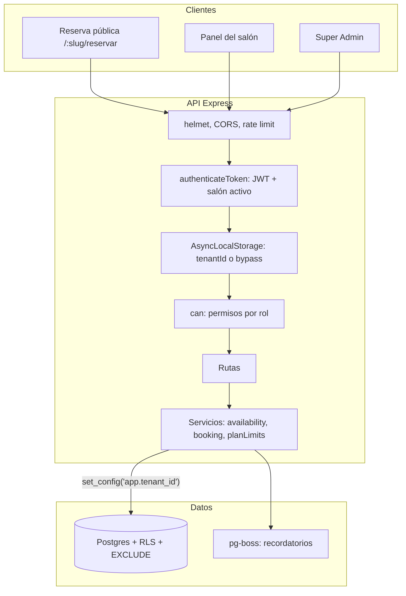
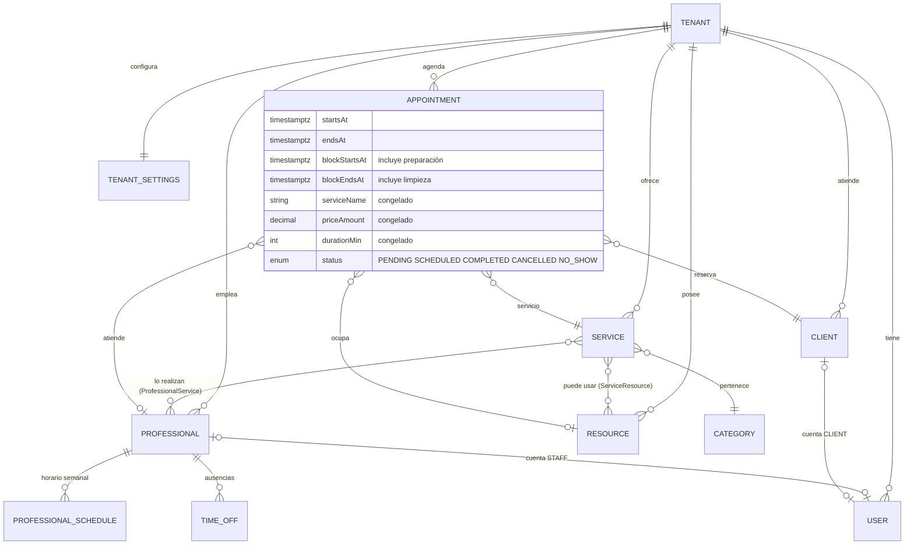

# Arquitectura

## Multi-tenant

Una sola base de datos y un solo schema. Cada tabla de negocio lleva `tenantId` y está protegida con Row-Level Security.

Cómo se garantiza el aislamiento (de la capa más externa a la última defensa):

1. `authenticateToken` verifica el JWT, comprueba que el salón exista y no esté suspendido, y abre un contexto de tenant (`lib/tenantContext.ts`).
2. El cliente Prisma (`prismaClient.ts`) ejecuta cada consulta en una transacción que fija `app.tenant_id` (`set_config(..., true)`).
3. Las políticas RLS (migración `row_level_security`) solo dejan ver y escribir filas de ese tenant. Sin contexto no se ve ninguna fila.
4. Los tests de `src/tests/tenantIsolation.test.ts` fallan si una tabla con `tenantId` no tiene RLS forzada.

Reglas para el código nuevo:

- Transacciones: `runInTransaction` de `lib/db.ts`, nunca `prisma.$transaction` (hay un test que lo vigila).
- Una consulta Prisma es perezosa: dentro de `runWithTenant(id, () => prisma.x.findMany())` el helper ya la convierte en Promise; fuera de él, haz `await` dentro del callback.
- Rutas de plataforma: `runAsAdmin` (lo aplica `authenticatePlatformAdmin`).

## Modelo de dominio

Una cita es un servicio, hecho por un profesional, opcionalmente en un recurso, en un intervalo de tiempo.

Garantías de la base de datos sobre `Appointment`:

- `EXCLUDE USING gist` por profesional y por recurso sobre `[blockStartsAt, blockEndsAt)` para citas `SCHEDULED`/`PENDING`: dos reservas simultáneas del mismo hueco nunca se confirman las dos.
- El precio, nombre y duración del servicio se congelan al reservar.

## Disponibilidad

`services/availability/engine.ts` calcula los huecos; `booking.ts` crea, reprograma y cancela recalculando dentro de una transacción SERIALIZABLE. Capas que se aplican, en orden: día cerrado, excepción de fecha, horario comercial, tope diario, antelación mínima y máxima (solo clientes), horario del profesional, ausencias, citas existentes con sus buffers, recurso libre.

La hora local de cada salón se guarda como instante absoluto usando `Tenant.timezone` (`lib/time.ts`).

## Roles

| Rol | Alcance |
|---|---|
| `OWNER` | Todo, incluidos plan y cuentas de profesionales |
| `ADMIN` | Opera el salón (agenda, catálogo, clientes, ajustes) |
| `STAFF` | Solo su propia agenda; lee clientes y catálogo |
| `CLIENT` | Cuenta de cliente final (portal) |
| `PlatformAdmin` | Super Admin, JWT y secreto aparte |

Tabla de permisos en `middleware/can.ts`.

## Verticales

`TenantSettings.vertical` + `services/verticalTemplates.ts`: al crear un salón se precargan servicios, recursos, horario y vocabulario según el tipo de negocio (manicura, barbería, spa, tatuajes, peluquería, entrenamiento, genérico). El vocabulario (`labels`) lo usa la interfaz vía `useLabels`.
