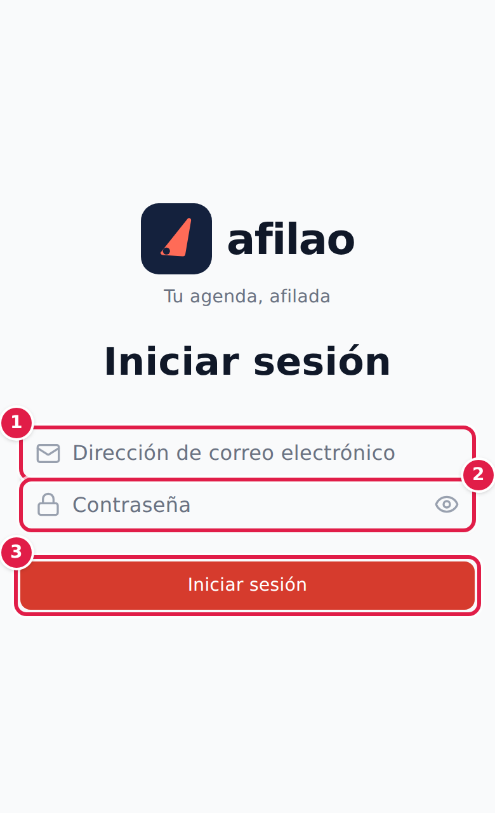
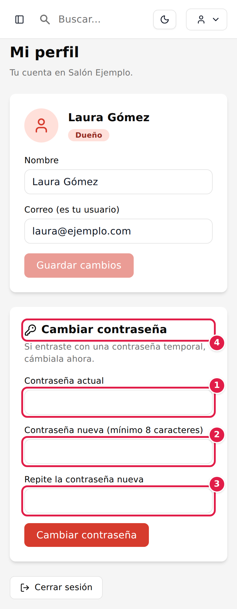
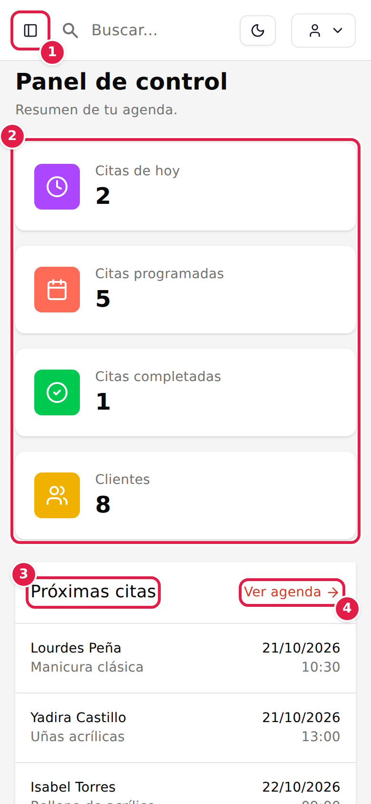
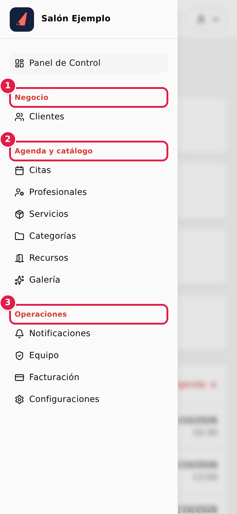
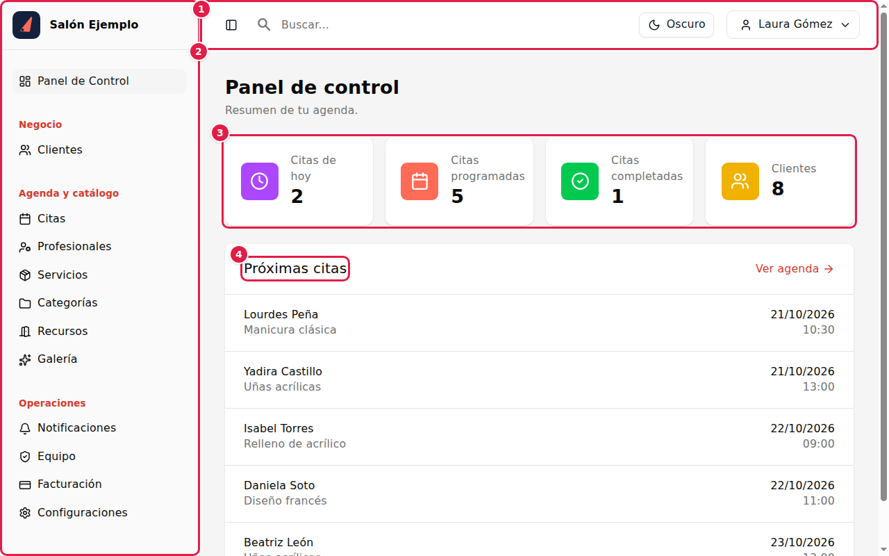
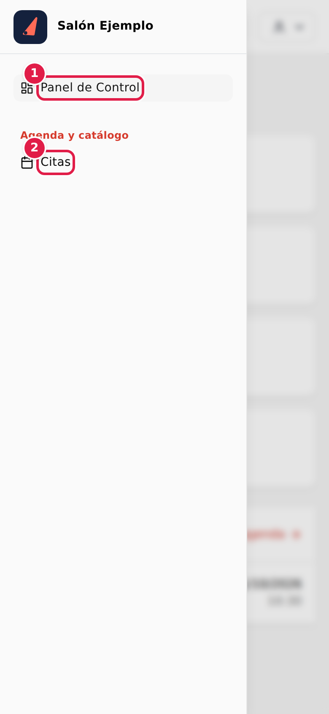

# Afilao · Manual de usuario

**[ LOGO DE AFILAO ]**

*Tu agenda, afilada.*

| | |
|---|---|
| **Sistema** | Afilao, agenda de citas para negocios de servicios |
| **Versión del sistema** | 1.0 |
| **Fecha del manual** | Octubre de 2026 |
| **Idioma** | Español |
| **Para quién es** | Dueños, gerentes y profesionales de un negocio |
| **Soporte** | yordenis@yordeniscorreoso.com · +1 (305) 792-8837 · de 9am a 5pm |

---

# 2. Índice

**Empezar**

1. Portada
2. Índice
3. [Cómo usar este manual](#3-cómo-usar-este-manual)
4. [¿Qué es Afilao?](#4-qué-es-afilao)
5. [Antes de empezar](#5-antes-de-empezar)
6. [Primeros pasos](#6-primeros-pasos)

**El día a día**

7. [Citas](#7-citas)
8. [Clientes](#8-clientes)
9. [Tu página de reserva](#9-tu-página-de-reserva)
10. [El bot de Telegram](#10-el-bot-de-telegram)

**Monta tu negocio**

11. [Servicios y Categorías](#11-servicios-y-categorías)
12. [Profesionales](#12-profesionales)
13. [Configuración](#13-configuración)
14. [Equipo y Mi perfil](#14-equipo-y-mi-perfil)
15. [Recursos, Galería, Notificaciones y Facturación](#15-recursos-galería-notificaciones-y-facturación)

**Ayuda**

16. [Tareas de principio a fin](#16-tareas-de-principio-a-fin)
17. [Preguntas frecuentes](#17-preguntas-frecuentes)
18. [Solución de problemas](#18-solución-de-problemas)
19. [Glosario](#19-glosario)
20. [Cómo contactar a soporte](#20-cómo-contactar-a-soporte)

> ❓ **Nota:** ¿Buscas algo con prisa? Ve directo al capítulo [18. Solución de problemas](#18-solución-de-problemas) o al [17. Preguntas frecuentes](#17-preguntas-frecuentes).

---

# 3. Cómo usar este manual

Este manual te explica Afilao paso a paso. No necesitas saber de computadoras.

No hace falta que lo leas de principio a fin. Abre el capítulo de lo que quieres hacer. Cada capítulo se entiende solo.

## Cómo está escrito

- Los **nombres de botones, menús y campos** salen en negrita. Son exactamente como los ves en la pantalla. Ejemplo: pulsa **Guardar**.
- Los caminos por el menú se escriben con una flecha. Ejemplo: **Menú › Configuraciones › Reservas**. Significa: abre el menú, pulsa **Configuraciones** y luego la ficha **Reservas**.
- Cada tarea se explica en **pasos numerados**. Un paso es una sola acción.
- Los avisos que ves en pantalla salen en *cursiva*. Ejemplo: *Perfil guardado correctamente*.

## Los iconos de los avisos

| Icono | Qué significa |
|---|---|
| 💡 **Consejo** | Un truco para hacerlo más rápido o mejor. |
| ⚠️ **Atención** | Algo que debes cuidar para no equivocarte. |
| ✅ **Resultado esperado** | Lo que debes ver cuando terminas bien un paso. |
| ❓ **Nota** | Información extra que te puede aclarar dudas. |
| 📸 **Captura** | Una imagen de la pantalla. Los números rojos en la imagen coinciden con los pasos del texto. |

## Las capturas de pantalla

Casi todas las capturas son del celular, porque es el uso más común. En el computador las pantallas son iguales, pero el menú está siempre visible a la izquierda.

Los **recuadros rojos con números** señalan dónde pulsar o dónde mirar. El número 1 es lo primero, el 2 lo segundo, y así.

## Los nombres cambian según tu negocio

Afilao usa palabras distintas según el tipo de negocio. Una barbería dice **turno** y **barbero**. Un salón de uñas dice **clienta** y **manicurista**.

En este manual usamos **cliente**, **cita** y **profesional**. Si tu negocio usa otras palabras, verás esas en tu pantalla. Funcionan igual.

> ❓ **Nota:** Puedes cambiar estas palabras en **Configuraciones › Negocio › Vocabulario**. Lo explicamos en el [capítulo 13](#13-configuración).

---

# 4. ¿Qué es Afilao?

Afilao es una agenda de citas por internet para tu negocio. Sirve para barberías, salones de uñas, peluquerías, spas y negocios parecidos.

## Qué ganas con Afilao

- **Tus clientes reservan solos.** Lo hacen desde su celular, a cualquier hora, sin crear una cuenta.
- **Ves toda tu agenda en un solo lugar.** Sabes quién viene, cuándo y con qué profesional.
- **Tienes menos llamadas y menos citas olvidadas.** Afilao avisa a tus clientes por correo y por Telegram.
- **Compartes un solo enlace.** Lo pones en tu Instagram o WhatsApp. También puedes imprimir un cartel con un código QR.
- **Cada profesional ve solo lo suyo.** Su agenda y sus clientes. Nada más.
- **No instalas nada.** Funciona en el celular, la tableta y el computador.

## Quién usa Afilao en tu negocio

Hay tres tipos de usuario. Cada uno ve cosas distintas.

| Tipo de usuario | Qué hace | Qué ve |
|---|---|---|
| **Dueño** | Dirige el negocio. | Todo. Es el único que ve **Equipo** y **Facturación**. |
| **Gerente** | Administra el negocio día a día. | Todo, menos **Equipo** y **Facturación**. |
| **Profesional** | Atiende a los clientes. | Su propia agenda y su perfil. |

## Y tus clientes, ¿qué ven?

Tus clientes **no tienen cuenta ni contraseña**. Entran a tu página de reserva, eligen su servicio, su día y su hora, y listo.

Reciben un enlace secreto para cambiar o cancelar su cita. Lo explicamos en el [capítulo 9](#9-tu-página-de-reserva).

---

# 5. Antes de empezar

## Lo que necesitas

- Un celular, una tableta o un computador con internet.
- Un navegador actualizado: Chrome, Edge, Safari o Firefox.
- Tu **correo** y tu **contraseña temporal**.
- El **enlace de tu salón**.

## Cómo recibes tus datos

El equipo de Afilao crea tu salón. Después te envía tres cosas:

1. El enlace para entrar. Se ve así: `[el enlace de tu salón]/[código de tu salón]/login`.
2. Tu correo. Es tu usuario.
3. Una contraseña temporal.

> ⚠️ **Atención:** Guarda el enlace de tu salón. Ponlo en los favoritos de tu navegador. Así entras siempre con un solo toque.

## Entra por primera vez

1. Abre el enlace de tu salón en tu navegador.
2. Escribe tu correo en **Dirección de correo electrónico** (ver Captura 1, número 1).
3. Escribe la contraseña temporal en **Contraseña** (número 2).
4. Pulsa **Iniciar sesión** (número 3).

> 📸 **Captura 1** — Pantalla de inicio de sesión. Elementos a resaltar: 1) campo de correo, 2) campo de contraseña, 3) botón **Iniciar sesión**. Encuadre: pantalla completa del móvil. Nombre de archivo sugerido: `01_login.png`

✅ **Resultado esperado:** Ves la pantalla **Panel de control**.

💡 **Consejo:** Toca el icono del ojo, dentro del campo **Contraseña**, para ver lo que escribes.

> ❓ **Nota:** Si entras desde la dirección general de Afilao, sin el código de tu salón, verás un campo más: **Código del salón (ej. mi-salon)**. Escribe ahí el código que te dio soporte.

### ⚠️ Si algo sale mal

| Ves este mensaje | Qué hacer |
|---|---|
| *Salón, correo electrónico o contraseña inválidos* | Revisa que no haya espacios de más. Copia y pega la contraseña temporal. Comprueba tu correo. |
| *Demasiados intentos. Inténtalo de nuevo en unos minutos.* | Espera unos minutos y vuelve a intentarlo. |
| *Este salón está suspendido. Contacta a soporte.* | Escribe a soporte. Los datos están en el [capítulo 20](#20-cómo-contactar-a-soporte). |

## Cambia tu contraseña temporal

Hazlo la primera vez que entras. Así nadie más usa tu contraseña.

1. Pulsa el botón con el icono de persona, arriba a la derecha.
2. Elige **Mi Perfil**.
3. Baja hasta la sección **Cambiar contraseña**.
4. Escribe tu contraseña temporal en **Contraseña actual** (Captura 2, número 1).
5. Escribe la nueva en **Contraseña nueva (mínimo 8 caracteres)** (número 2).
6. Repite la nueva en **Repite la contraseña nueva** (número 3).
7. Pulsa **Cambiar contraseña** (número 4).

> 📸 **Captura 2** — Pantalla **Mi perfil**, sección **Cambiar contraseña**. Elementos a resaltar: 1) **Contraseña actual**, 2) **Contraseña nueva**, 3) **Repite la contraseña nueva**, 4) botón **Cambiar contraseña**. Encuadre: pantalla completa del móvil. Nombre de archivo sugerido: `02_mi_perfil_contrasena.png`

✅ **Resultado esperado:** Ves el aviso *Contraseña cambiada. Las demás sesiones se cerraron.*

> ❓ **Nota:** "Las demás sesiones se cerraron" significa que, si estabas dentro en otro celular o computador, ahí tendrás que entrar de nuevo con la contraseña nueva.

💡 **Consejo:** Elige una contraseña que recuerdes, pero que otros no adivinen. No uses tu fecha de nacimiento.

### ⚠️ Si algo sale mal

| Ves este mensaje | Qué hacer |
|---|---|
| *La contraseña actual no es correcta* | Escribe de nuevo la contraseña que usas ahora. Cuidado con las mayúsculas. |
| *Las contraseñas nuevas no coinciden* | Escribe la misma contraseña en los dos campos. |
| *La nueva contraseña debe ser distinta de la actual* | Elige una contraseña diferente a la anterior. |

## Cierra la sesión

Cierra la sesión cuando uses un celular o computador que no es tuyo.

1. Pulsa el botón con el icono de persona, arriba a la derecha.
2. Elige **Cerrar Sesión**.

✅ **Resultado esperado:** Vuelves a la pantalla **Iniciar sesión**.

---

# 6. Primeros pasos

Aquí conoces la pantalla principal y el menú. En cinco minutos sabrás dónde está todo.

## La pantalla Panel de control

Es lo primero que ves al entrar. Te da un resumen de tu día.

> 📸 **Captura 3** — Pantalla **Panel de control** en el móvil. Elementos a resaltar: 1) botón de menú, 2) las cuatro tarjetas de resumen, 3) lista **Próximas citas**, 4) enlace **Ver agenda**. Encuadre: pantalla completa del móvil. Nombre de archivo sugerido: `03_panel_movil.png`

1. **Botón de menú** (número 1). Es un cuadro con una barra a la izquierda. Abre el menú.
2. **Tarjetas de resumen** (número 2). Muestran números de tu negocio:
   - **Citas de hoy**: cuántas citas tienes hoy.
   - **Citas programadas**: cuántas citas tienes por delante.
   - **Citas completadas**: cuántas ya terminaste.
   - **Clientes**: cuántos clientes tienes guardados.
3. **Próximas citas** (número 3). Las siguientes citas, con cliente, servicio, día y hora.
4. **Ver agenda** (número 4). Te lleva a tu agenda completa.

> ❓ **Nota:** Arriba a la derecha tienes también un botón con una luna. Cambia entre el modo claro y el oscuro. Elige el que te canse menos la vista.

## El menú

El menú tiene todo lo que puedes hacer. Ábrelo con el botón de menú.

> 📸 **Captura 4** — Menú del móvil abierto. Elementos a resaltar: 1) grupo **Negocio**, 2) grupo **Agenda y catálogo**, 3) grupo **Operaciones**. Encuadre: pantalla completa del móvil. Nombre de archivo sugerido: `04_menu_movil.png`

El menú tiene tres grupos (números 1, 2 y 3). Esto hace cada opción:

| Opción | Para qué sirve | Quién la ve |
|---|---|---|
| **Panel de Control** | Ver el resumen de tu día. | Todos |
| **Clientes** | Guardar y buscar a tus clientes. | Dueño y gerente |
| **Citas** | Ver, crear y cambiar citas. | Todos. El profesional ve solo las suyas. |
| **Profesionales** | Crear las fichas de tu equipo y sus horarios. | Dueño y gerente |
| **Servicios** | Lo que ofreces, con precio y duración. | Dueño y gerente |
| **Categorías** | Agrupar tus servicios. | Dueño y gerente |
| **Recursos** | Sillas, cabinas o salas que se pueden ocupar. | Dueño y gerente |
| **Galería** | Fotos de tus trabajos para inspirar a tus clientes. | Dueño y gerente |
| **Notificaciones** | Ver qué avisos se enviaron a tus clientes. | Dueño y gerente |
| **Equipo** | Crear las cuentas de tu gente. | Solo el dueño |
| **Facturación** | Ver tu plan de Afilao. | Solo el dueño |
| **Configuraciones** | Horarios, reservas, marca y avisos de tu negocio. | Dueño y gerente |

Para cerrar el menú, toca fuera de él.

## En el computador

En una pantalla grande el menú está siempre visible a la izquierda. No tienes que abrirlo.

> 📸 **Captura 5** — Pantalla **Panel de control** en el computador. Elementos a resaltar: 1) menú lateral, 2) barra superior, 3) tarjetas de resumen, 4) **Próximas citas**. Encuadre: pantalla completa. Nombre de archivo sugerido: `05_panel_pc.png`

1. **Menú lateral** (número 1): siempre visible.
2. **Barra superior** (número 2): tiene el botón del modo oscuro y tu menú de usuario.
3. **Tarjetas de resumen** (número 3).
4. **Próximas citas** (número 4).

## Si eres profesional

El profesional ve un menú más corto. Solo tiene **Panel de Control** y **Citas**.

> 📸 **Captura 6** — Menú del móvil de una cuenta de profesional. Elementos a resaltar: 1) **Panel de Control**, 2) **Citas**. Encuadre: pantalla completa del móvil. Nombre de archivo sugerido: `06_panel_profesional.png`

Como profesional:

1. Pulsa **Citas** (número 2) para ver tu agenda. Solo ves tus citas.
2. Pulsa el icono de persona, arriba a la derecha, y luego **Mi Perfil** para cambiar tu contraseña o vincular Telegram.

> ❓ **Nota:** Si necesitas ver algo que no aparece en tu menú, pídeselo al dueño o al gerente. Cada uno ve solo lo que le toca.

### ⚠️ Si algo sale mal

| Qué pasa | Qué hacer |
|---|---|
| No ves el botón de menú. | Estás en una pantalla grande. El menú ya está a la izquierda. |
| Falta una opción en el menú. | Tu tipo de usuario no la tiene. Pregunta al dueño. |
| El **Panel de control** muestra ceros. | Aún no tienes citas ni clientes. Es normal en un negocio nuevo. |
