# Afilao · Manual de usuario

**[ LOGO DE AFILAO ]**

*Tu agenda, afilada.*

| | |
|---|---|
| **Sistema** | Afilao, agenda de citas para negocios de servicios |
| **Versión del sistema** | 1.0 |
| **Fecha del manual** | Octubre de 2026 |
| **Idioma** | Español |
| **Para quién es** | Dueños, gerentes y profesionales de un negocio |
| **Soporte** | yordenis@yordeniscorreoso.com · +1 (305) 792-8837 · de 9am a 5pm |

---

# 2. Índice

**Empezar**

1. Portada
2. Índice
3. [Cómo usar este manual](#3-cómo-usar-este-manual)
4. [¿Qué es Afilao?](#4-qué-es-afilao)
5. [Antes de empezar](#5-antes-de-empezar)
6. [Primeros pasos](#6-primeros-pasos)

**El día a día**

7. [Citas](#7-citas)
8. [Clientes](#8-clientes)
9. [Tu página de reserva](#9-tu-página-de-reserva)
10. [El bot de Telegram](#10-el-bot-de-telegram)

**Monta tu negocio**

11. [Servicios y Categorías](#11-servicios-y-categorías)
12. [Profesionales](#12-profesionales)
13. [Configuración](#13-configuración)
14. [Equipo y Mi perfil](#14-equipo-y-mi-perfil)
15. [Recursos, Galería, Notificaciones y Facturación](#15-recursos-galería-notificaciones-y-facturación)

**Ayuda**

16. [Tareas de principio a fin](#16-tareas-de-principio-a-fin)
17. [Preguntas frecuentes](#17-preguntas-frecuentes)
18. [Solución de problemas](#18-solución-de-problemas)
19. [Glosario](#19-glosario)
20. [Cómo contactar a soporte](#20-cómo-contactar-a-soporte)

> ❓ **Nota:** ¿Buscas algo con prisa? Ve directo al capítulo [18. Solución de problemas](#18-solución-de-problemas) o al [17. Preguntas frecuentes](#17-preguntas-frecuentes).

---

# 3. Cómo usar este manual

Este manual te explica Afilao paso a paso. No necesitas saber de computadoras.

No hace falta que lo leas de principio a fin. Abre el capítulo de lo que quieres hacer. Cada capítulo se entiende solo.

## Cómo está escrito

- Los **nombres de botones, menús y campos** salen en negrita. Son exactamente como los ves en la pantalla. Ejemplo: pulsa **Guardar**.
- Los caminos por el menú se escriben con una flecha. Ejemplo: **Menú › Configuraciones › Reservas**. Significa: abre el menú, pulsa **Configuraciones** y luego la ficha **Reservas**.
- Cada tarea se explica en **pasos numerados**. Un paso es una sola acción.
- Los avisos que ves en pantalla salen en *cursiva*. Ejemplo: *Perfil guardado correctamente*.

## Los iconos de los avisos

| Icono | Qué significa |
|---|---|
| 💡 **Consejo** | Un truco para hacerlo más rápido o mejor. |
| ⚠️ **Atención** | Algo que debes cuidar para no equivocarte. |
| ✅ **Resultado esperado** | Lo que debes ver cuando terminas bien un paso. |
| ❓ **Nota** | Información extra que te puede aclarar dudas. |
| 📸 **Captura** | Una imagen de la pantalla. Los números rojos en la imagen coinciden con los pasos del texto. |

## Las capturas de pantalla

Casi todas las capturas son del celular, porque es el uso más común. En el computador las pantallas son iguales, pero el menú está siempre visible a la izquierda.

Los **recuadros rojos con números** señalan dónde pulsar o dónde mirar. El número 1 es lo primero, el 2 lo segundo, y así.

## Los nombres cambian según tu negocio

Afilao usa palabras distintas según el tipo de negocio. Una barbería dice **turno** y **barbero**. Un salón de uñas dice **clienta** y **manicurista**.

En este manual usamos **cliente**, **cita** y **profesional**. Si tu negocio usa otras palabras, verás esas en tu pantalla. Funcionan igual.

> ❓ **Nota:** Puedes cambiar estas palabras en **Configuraciones › Negocio › Vocabulario**. Lo explicamos en el [capítulo 13](#13-configuración).

---

# 4. ¿Qué es Afilao?

Afilao es una agenda de citas por internet para tu negocio. Sirve para barberías, salones de uñas, peluquerías, spas y negocios parecidos.

## Qué ganas con Afilao

- **Tus clientes reservan solos.** Lo hacen desde su celular, a cualquier hora, sin crear una cuenta.
- **Ves toda tu agenda en un solo lugar.** Sabes quién viene, cuándo y con qué profesional.
- **Tienes menos llamadas y menos citas olvidadas.** Afilao avisa a tus clientes por correo y por Telegram, una aplicación de mensajes como WhatsApp.
- **Compartes un solo enlace.** Lo pones en tu Instagram o WhatsApp. También puedes imprimir un cartel con un código QR. Es un cuadro con puntos que el celular lee con la cámara.
- **Cada profesional ve solo lo suyo.** Su agenda y sus clientes. Nada más.
- **No instalas nada.** Funciona en el celular, la tableta y el computador.

## Quién usa Afilao en tu negocio

Hay tres tipos de usuario. Cada uno ve cosas distintas.

| Tipo de usuario | Qué hace | Qué ve |
|---|---|---|
| **Dueño** | Dirige el negocio. | Todo. Es el único que ve **Equipo** y **Facturación**. |
| **Gerente** | Administra el negocio día a día. | Todo, menos **Equipo** y **Facturación**. |
| **Profesional** | Atiende a los clientes. | Su propia agenda y su perfil. |

## Y tus clientes, ¿qué ven?

Tus clientes **no tienen cuenta ni contraseña**. Entran a tu página de reserva, eligen su servicio, su día y su hora, y listo.

Reciben un enlace secreto para cambiar o cancelar su cita. Lo explicamos en el [capítulo 9](#9-tu-página-de-reserva).

---

# 5. Antes de empezar

## Lo que necesitas

- Un celular, una tableta o un computador con internet.
- Un navegador actualizado. Es el programa con el que abres internet: Chrome, Edge, Safari o Firefox.
- Tu **correo** y tu **contraseña temporal**.
- El **enlace de tu salón**.

## Cómo recibes tus datos

El equipo de Afilao crea tu salón. Después te envía tres cosas:

1. El enlace para entrar. Se ve así: `[el enlace de tu salón]/[código de tu salón]/login`.
2. Tu correo. Es tu usuario.
3. Una contraseña temporal.

> ⚠️ **Atención:** Guarda el enlace de tu salón. Ponlo en los favoritos de tu navegador. Así entras siempre con un solo toque.

## Entra por primera vez

1. Abre el enlace de tu salón en tu navegador.
2. Escribe tu correo en **Dirección de correo electrónico** (ver Captura 1, número 1).
3. Escribe la contraseña temporal en **Contraseña** (número 2).
4. Pulsa **Iniciar sesión** (número 3).

> 📸 **Captura 1** — Pantalla de inicio de sesión. Elementos a resaltar: 1) campo de correo, 2) campo de contraseña, 3) botón **Iniciar sesión**. Encuadre: pantalla completa del móvil. Nombre de archivo sugerido: `01_login.png`

✅ **Resultado esperado:** Ves la pantalla **Panel de control**.

💡 **Consejo:** Toca el icono del ojo, dentro del campo **Contraseña**, para ver lo que escribes.

> ❓ **Nota:** Si entras desde la dirección general de Afilao, sin el código de tu salón, verás un campo más: **Código del salón (ej. mi-salon)**. Escribe ahí el código que te dio soporte.

### ⚠️ Si algo sale mal

| Ves este mensaje | Qué hacer |
|---|---|
| *Salón, correo electrónico o contraseña inválidos* | Revisa que no haya espacios de más. Copia y pega la contraseña temporal. Comprueba tu correo. |
| *Demasiados intentos. Inténtalo de nuevo en unos minutos.* | Espera unos minutos y vuelve a intentarlo. |
| *Este salón está suspendido. Contacta a soporte.* | Escribe a soporte. Los datos están en el [capítulo 20](#20-cómo-contactar-a-soporte). |

## Cambia tu contraseña temporal

Hazlo la primera vez que entras. Así nadie más usa tu contraseña.

1. Pulsa el botón con el icono de persona, arriba a la derecha.
2. Elige **Mi Perfil**.
3. Baja hasta la sección **Cambiar contraseña**.
4. Escribe tu contraseña temporal en **Contraseña actual** (Captura 2, número 1).
5. Escribe la nueva en **Contraseña nueva (mínimo 8 caracteres)** (número 2).
6. Repite la nueva en **Repite la contraseña nueva** (número 3).
7. Pulsa **Cambiar contraseña** (número 4).

> 📸 **Captura 2** — Pantalla **Mi perfil**, sección **Cambiar contraseña**. Elementos a resaltar: 1) **Contraseña actual**, 2) **Contraseña nueva**, 3) **Repite la contraseña nueva**, 4) botón **Cambiar contraseña**. Encuadre: pantalla completa del móvil. Nombre de archivo sugerido: `02_mi_perfil_contrasena.png`

✅ **Resultado esperado:** Ves el aviso *Contraseña cambiada. Las demás sesiones se cerraron.*

> ❓ **Nota:** *Las demás sesiones se cerraron* significa que te sacamos de los otros dispositivos. Si estabas dentro en otro celular o computador, entra de nuevo con la contraseña nueva.

💡 **Consejo:** Elige una contraseña que recuerdes, pero que otros no adivinen. No uses tu fecha de nacimiento.

### ⚠️ Si algo sale mal

| Ves este mensaje | Qué hacer |
|---|---|
| *La contraseña actual no es correcta* | Escribe de nuevo la contraseña que usas ahora. Cuidado con las mayúsculas. |
| *Las contraseñas nuevas no coinciden* | Escribe la misma contraseña en los dos campos. |
| *La nueva contraseña debe ser distinta de la actual* | Elige una contraseña diferente a la anterior. |

## Cierra la sesión

Cierra la sesión cuando uses un celular o computador que no es tuyo.

1. Pulsa el botón con el icono de persona, arriba a la derecha.
2. Elige **Cerrar Sesión**.

✅ **Resultado esperado:** Vuelves a la pantalla **Iniciar sesión**.

---

# 6. Primeros pasos

Aquí conoces la pantalla principal y el menú. En cinco minutos sabrás dónde está todo.

## La pantalla Panel de control

Es lo primero que ves al entrar. Te da un resumen de tu día.

👉 Mira la **Captura 3**.

> 📸 **Captura 3** — Pantalla **Panel de control** en el móvil. Elementos a resaltar: 1) botón de menú, 2) las cuatro tarjetas de resumen, 3) lista **Próximas citas**, 4) enlace **Ver agenda**. Encuadre: pantalla completa del móvil. Nombre de archivo sugerido: `03_panel_movil.png`

1. Botón de menú (número 1). Es un cuadro con una barra a la izquierda. Abre el menú.
2. Tarjetas de resumen (número 2). Muestran números de tu negocio:
   - **Citas de hoy**: cuántas citas tienes hoy.
   - **Citas programadas**: cuántas citas tienes por delante.
   - **Citas completadas**: cuántas ya terminaste.
   - **Clientes**: cuántos clientes tienes guardados.
3. **Próximas citas** (número 3). Las siguientes citas, con cliente, servicio, día y hora.
4. **Ver agenda** (número 4). Te lleva a tu agenda completa.

Si tienes citas por delante, arriba de las tarjetas ves la tarjeta **Siguiente cita**.

👉 Mira la **Captura 46**.

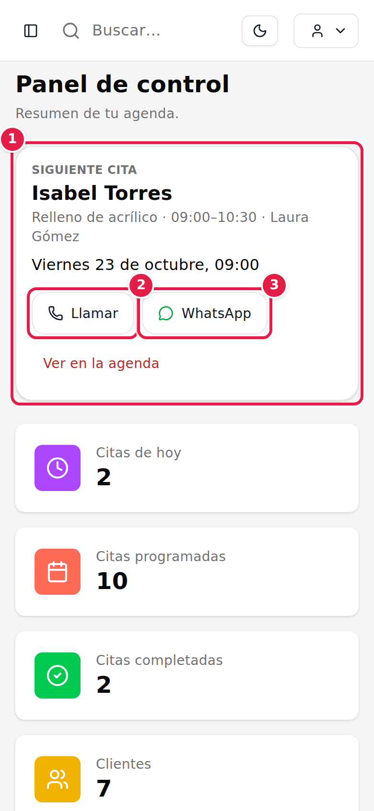

> 📸 **Captura 46** — **Panel de control** con la tarjeta **Siguiente cita**. Elementos a resaltar: 1) tarjeta **Siguiente cita**, 2) botón **Llamar**, 3) botón **WhatsApp**. Encuadre: pantalla completa del móvil. Nombre de archivo sugerido: `46_siguiente_cita.png`

La tarjeta (número 1) te dice quién viene, para qué servicio y cuándo, por ejemplo *Hoy a las 13:00 · en 25 min*. Con **Llamar** (número 2) y **WhatsApp** (número 3) hablas con el cliente sin buscar su número. Si la cita ya empezó, la tarjeta dice **Ahora** y tiene un botón **Completar**.

### El buscador

Arriba, junto al botón de menú, hay un campo **Buscar…**. Escribe dos letras o más y verás los clientes y las citas que coinciden.

👉 Mira la **Captura 45**.

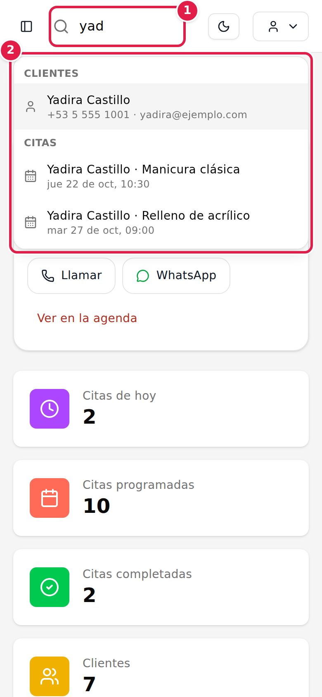

> 📸 **Captura 45** — Buscador con el texto *yad*. Elementos a resaltar: 1) campo de búsqueda, 2) lista de resultados con **Clientes** y **Citas**. Encuadre: pantalla completa del móvil. Nombre de archivo sugerido: `45_buscador.png`

Toca un resultado para ir a él. Mira el [capítulo 7](#7-citas) para más detalle.

> ❓ **Nota:** Arriba a la derecha tienes también un botón con una luna. Cambia entre el modo claro y el oscuro. Elige el que te canse menos la vista.

## El menú

El menú tiene todo lo que puedes hacer. Ábrelo con el botón de menú.

👉 Mira la **Captura 4**.

> 📸 **Captura 4** — Menú del móvil abierto. Elementos a resaltar: 1) grupo **Negocio**, 2) grupo **Agenda y catálogo**, 3) grupo **Operaciones**. Encuadre: pantalla completa del móvil. Nombre de archivo sugerido: `04_menu_movil.png`

El menú tiene tres grupos (números 1, 2 y 3). Esto hace cada opción:

| Opción | Para qué sirve | Quién la ve |
|---|---|---|
| **Panel de Control** | Ver el resumen de tu día. | Todos |
| **Clientes** | Guardar y buscar a tus clientes. | Dueño y gerente |
| **Citas** | Ver, crear y cambiar citas. | Todos. El profesional ve solo las suyas. |
| **Profesionales** | Crear las fichas de tu equipo y sus horarios. | Dueño y gerente |
| **Servicios** | Lo que ofreces, con precio y duración. | Dueño y gerente |
| **Categorías** | Agrupar tus servicios. | Dueño y gerente |
| **Recursos** | Sillas, cabinas o salas que se pueden ocupar. | Dueño y gerente |
| **Galería** | Fotos de tus trabajos para inspirar a tus clientes. | Dueño y gerente |
| **Notificaciones** | Ver qué avisos se enviaron a tus clientes. | Dueño y gerente |
| **Equipo** | Crear las cuentas de tu gente. | Solo el dueño |
| **Facturación** | Ver tu plan de Afilao. | Solo el dueño |
| **Configuraciones** | Horarios, reservas, marca y avisos de tu negocio. | Dueño y gerente |

Para cerrar el menú, toca fuera de él.

## En el computador

En una pantalla grande el menú está siempre visible a la izquierda. No tienes que abrirlo.

👉 Mira la **Captura 5**.

> 📸 **Captura 5** — Pantalla **Panel de control** en el computador. Elementos a resaltar: 1) menú lateral, 2) barra superior, 3) tarjetas de resumen, 4) **Próximas citas**. Encuadre: pantalla completa. Nombre de archivo sugerido: `05_panel_pc.png`

1. Menú lateral (número 1): siempre visible.
2. Barra superior (número 2): tiene el botón del modo oscuro y tu menú de usuario.
3. Tarjetas de resumen (número 3).
4. **Próximas citas** (número 4).

## Si eres profesional

El profesional ve un menú más corto. Solo tiene **Panel de Control** y **Citas**.

👉 Mira la **Captura 6**.

> 📸 **Captura 6** — Menú del móvil de una cuenta de profesional. Elementos a resaltar: 1) **Panel de Control**, 2) **Citas**. Encuadre: pantalla completa del móvil. Nombre de archivo sugerido: `06_panel_profesional.png`

Como profesional:

1. Pulsa **Citas** (número 2) para ver tu agenda. Solo ves tus citas.
2. Pulsa el icono de persona, arriba a la derecha, y luego **Mi Perfil** para cambiar tu contraseña o vincular Telegram.

> ❓ **Nota:** Si necesitas ver algo que no aparece en tu menú, pídeselo al dueño o al gerente. Cada uno ve solo lo que le toca.

### ⚠️ Si algo sale mal

| Qué pasa | Qué hacer |
|---|---|
| No ves el botón de menú. | Estás en una pantalla grande. El menú ya está a la izquierda. |
| Falta una opción en el menú. | Tu tipo de usuario no la tiene. Pregunta al dueño. |
| El **Panel de control** muestra ceros. | Aún no tienes citas ni clientes. Es normal en un negocio nuevo. |

---

# 7. Citas

## Qué puedes hacer aquí

En **Citas** ves tu agenda. Creas citas nuevas. Confirmas, completas, cambias o cancelas las que ya existen. También puedes bloquear unas horas y avisar a un cliente por WhatsApp.

**Menú › Citas**

La pantalla cambia según el aparato. En el **celular** la agenda se divide en dos mitades: arriba el calendario y abajo las citas del día. En el **computador** ves la agenda con las vistas **Día** y **Semana**. Primero te explicamos el celular; el computador está más abajo.

## Conoce la pantalla en el celular

👉 Mira la **Captura 7**.

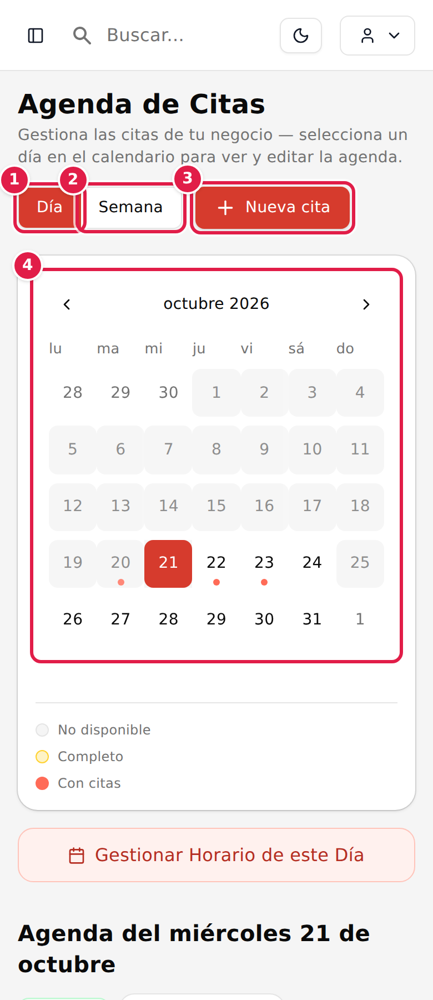

> 📸 **Captura 7** — Pantalla **Citas** en el móvil. Elementos a resaltar: 1) mes del calendario, 2) un día con citas (puntos de color), 3) asa para pasar de mes a semana, 4) lista de citas del día, 5) filtro **Todo el equipo**, 6) botón **+** de nueva cita. Encuadre: pantalla completa del móvil. Nombre de archivo sugerido: `07_agenda_calendario.png`

1. **Mes** (número 1). Usa las flechas **‹** y **›** para cambiar de mes. También puedes deslizar el calendario hacia los lados.
2. **Días con puntos** (número 2). Un punto de color significa que ese día tiene citas. Si tienes varios profesionales, cada uno tiene su color. Con un solo profesional, el color dice el estado: azul, agendada; amarillo, pendiente; verde, completada.
3. **Asa** (número 3). Es la barrita gris debajo del calendario. Tócala o deslízala para pasar de **mes** a **semana**.
4. **Citas del día** (número 4). Muestra las citas del día elegido, de la más temprana a la más tardía.
5. **Todo el equipo** (número 5). Elige a una persona para ver solo sus citas. Solo aparece si tienes varios profesionales.
6. **Botón +** (número 6). Crea una cita nueva.

El botón **Hoy** te lleva al día de hoy. Los días en gris están cerrados o fuera del mes.

> ❓ **Nota:** El día de hoy tiene un círculo rojo cuando lo eliges y un anillo azul cuando eliges otro.

## Ver un día

1. Pulsa **Citas** en el menú.
2. Toca el día que quieres en el calendario.
3. Mira la lista de abajo.

✅ **Resultado esperado:** Arriba de la lista ves el día, por ejemplo **Jueves 22 oct**, y cuántas citas tiene.

En la lista de un día verás, además de las citas:

| Lo que ves | Qué significa |
|---|---|
| Una línea roja con la hora, por ejemplo **17:43** | Es **ahora**. Solo sale en el día de hoy. |
| Un recuadro con rayitas y el texto **Libre 17:10–18:00 · 50 min** | Es un hueco libre. Tócalo para crear una cita en esa hora. |
| Un candado y **Bloqueado · Almuerzo** | Esas horas están bloqueadas. Nadie puede reservar. |
| **Tu negocio está cerrado este día** | Es un día de cierre o no abres ese día de la semana. |

> ❓ **Nota:** Los huecos libres se muestran por persona. Si tienes varios profesionales, elige a uno en **Todo el equipo** para verlos.

## Pasar de mes a semana

Cuando quieres ver más citas a la vez, usa la semana.

👉 Mira la **Captura 44**.

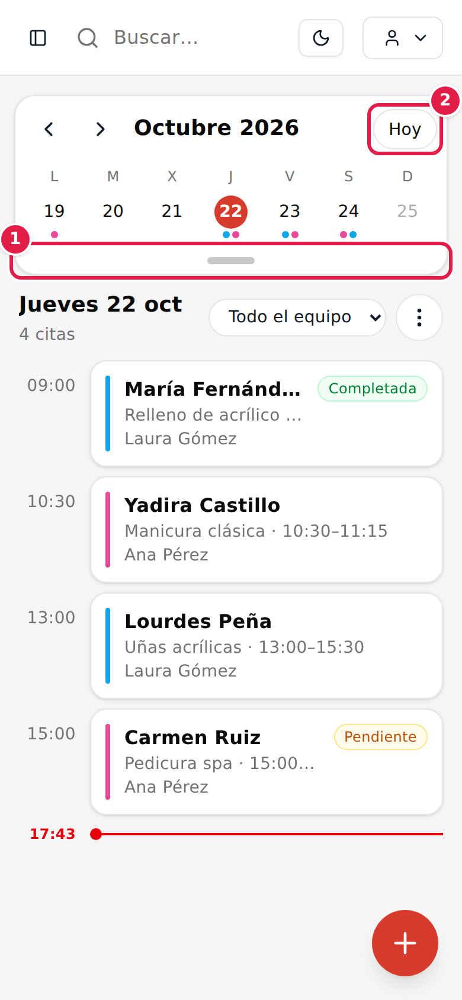

> 📸 **Captura 44** — Agenda en el móvil en modo **semana**. Elementos a resaltar: 1) asa, 2) botón **Hoy**. Encuadre: pantalla completa del móvil. Nombre de archivo sugerido: `44_agenda_semana_movil.png`

1. Toca el **asa** (número 1) o deslízala hacia arriba.
2. El calendario se reduce a una semana y la lista de citas gana espacio.
3. Para volver al mes, toca el asa otra vez o deslízala hacia abajo.

Con las flechas **‹** y **›** pasas de semana en semana. Pulsa **Hoy** (número 2) para volver a la semana actual.

> ❓ **Nota:** Afilao recuerda tu elección en ese celular. La próxima vez que abras Citas, verás el mismo modo.

## Crear una cita en pocos toques

En el celular, la cita nueva se hace en una hoja que sube desde abajo.

👉 Mira la **Captura 8**.

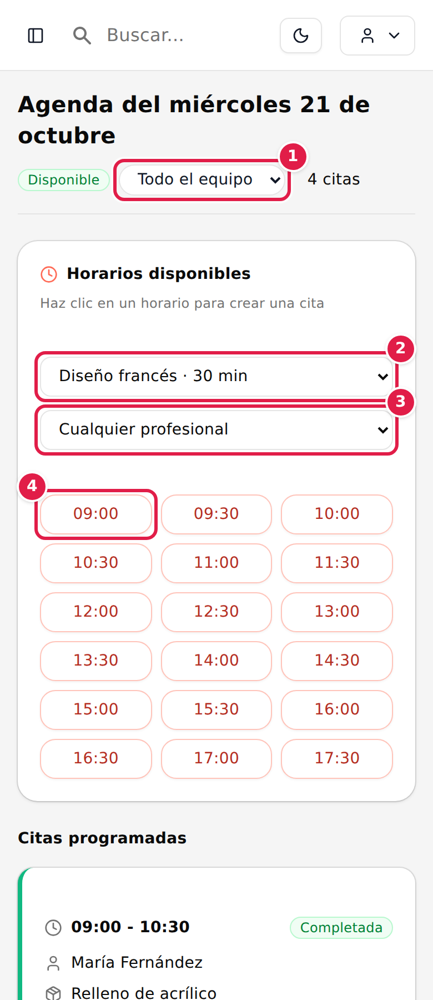

> 📸 **Captura 8** — Hoja **Nueva cita** en el móvil. Elementos a resaltar: 1) **Cliente**, 2) **Servicio**, 3) **Con quién**, 4) **Día**, 5) **Hora**. Encuadre: pantalla completa del móvil. Nombre de archivo sugerido: `08_agenda_horarios.png`

Hay tres formas de abrirla:

- Toca un **hueco libre** en la lista del día. Ya viene con la hora puesta.
- Pulsa el botón **+**.
- Desde otra cita, con **Próxima cita** (te lo explicamos más abajo).

Luego:

1. En **Cliente** (número 1), escribe el nombre o el teléfono y toca al cliente de la lista.
2. Toca el **Servicio** (número 2).
3. Si hay varios profesionales, toca **Con quién** (número 3). **Cualquiera** deja que Afilao elija.
4. Revisa el **Día** (número 4).
5. Toca una **Hora** (número 5). Solo salen horas libres.
6. Escribe una nota si quieres.
7. Pulsa **Agendar**.

✅ **Resultado esperado:** Ves el aviso *Se creó la cita* y la cita aparece en la lista del día.

### Si tu cliente no está en la lista

No necesitas salir de la hoja.

1. Escribe el nombre en **Cliente**.
2. Toca **Crear cliente «…»**.
3. Escribe su **Teléfono**.
4. Sigue con el servicio y la hora.

Al pulsar **Agendar**, Afilao guarda al cliente nuevo y crea la cita.

### ⚠️ Si algo sale mal

| Ves este mensaje | Qué hacer |
|---|---|
| **Elige primero un servicio.** | Toca un servicio. Las horas salen después. |
| **No hay horas libres ese día. Prueba con otro día.** | Ese profesional no trabaja ese día o ya tiene todo ocupado. Cambia el **Día** o la persona. |
| El botón **Agendar** está apagado. | Falta el cliente, el servicio o la hora. |
| *Esa hora ya no está disponible. Elige otra.* | Otra persona ocupó esa hora. Elige otra. |

## Tocar una cita

Toca cualquier cita de la lista. Se abre una hoja con todo lo que puedes hacer.

👉 Mira la **Captura 10**.

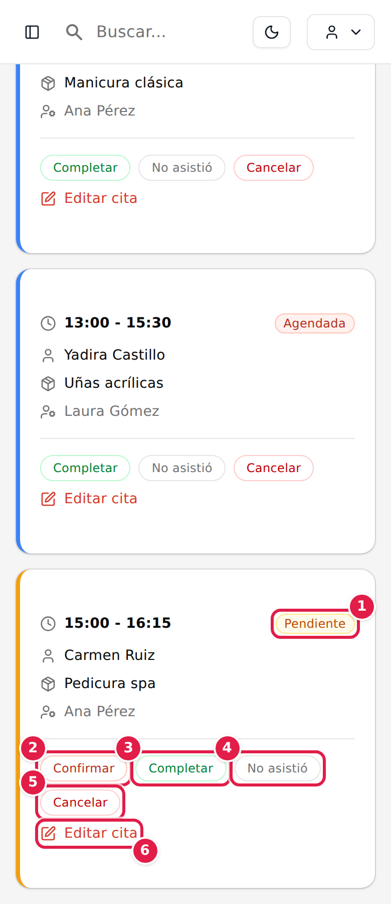

> 📸 **Captura 10** — Hoja de acciones de una cita **Agendada**. Elementos a resaltar: 1) **Llamar**, 2) **Enviar confirmación por WhatsApp**, 3) **Completar**, 4) **No asistió**, 5) **Próxima cita en**, 6) **Editar cita**, 7) **Cancelar cita**. Encuadre: pantalla completa del móvil. Nombre de archivo sugerido: `10_tarjeta_cita.png`

| Acción | Para qué sirve |
|---|---|
| **Llamar** | Abre el teléfono con el número del cliente. Solo sale si el cliente tiene teléfono. |
| **Enviar confirmación por WhatsApp** | Abre WhatsApp con un mensaje listo: *Hola Yadira, te confirmo tu cita en tu salón: Uñas acrílicas, jueves 22 de octubre a las 13:00. ¡Te esperamos!* Tú solo pulsas enviar. |
| **Confirmar** | Pasa una cita **Pendiente** a **Agendada**. |
| **Completar** | Marca que el cliente vino y ya lo atendiste. |
| **No asistió** | Marca que el cliente no vino. |
| **Próxima cita en 2, 3 o 4 sem** | Abre una cita nueva para el mismo cliente y servicio, dentro de esas semanas. |
| **Editar cita** | Abre la cita para cambiar sus datos. |
| **Cancelar cita** | Cancela la cita y avisa al cliente. |

Los estados que verás son: **Pendiente**, **Agendada**, **Completada**, **Cancelada** y **No asistió**.

> ❓ **Nota:** Si la cita ya pasó o está cancelada, solo ves las acciones que aún tienen sentido.

### Deshacer un cambio

Ya no hay cuadros que pregunten «¿seguro?». En su lugar, cada cambio se puede **deshacer** unos segundos.

1. Cambia el estado de una cita, por ejemplo pulsa **Completar**.
2. Abajo aparece un aviso con el botón **Deshacer**.
3. Púlsalo antes de que desaparezca para dejar la cita como estaba.

**Cancelar** funciona un poco distinto. Afilao espera **5 segundos** antes de cancelar de verdad. Así, si te equivocas y pulsas **Deshacer**, tu cliente nunca recibe el aviso de cancelación. Pasados los 5 segundos, la cita se cancela y se avisa al cliente.

> ⚠️ **Atención:** Si cierras la página en esos 5 segundos, la cancelación se hace igual. No se pierde.

## Agendar la próxima cita en un toque

En muchos negocios los clientes vuelven cada cierto tiempo. No tienes que buscar al cliente otra vez.

1. Toca la cita del cliente.
2. En **Próxima cita en**, toca **2 sem**, **3 sem** o **4 sem**.
3. Se abre la hoja **Nueva cita** con el mismo cliente, el mismo servicio, la misma persona y la misma hora, con el día movido esas semanas.
4. Si todo está bien, pulsa **Agendar**. Si esa hora ya está ocupada, toca otra de la lista.

✅ **Resultado esperado:** Ves el aviso *Se creó la cita*.

## Bloquear unas horas

Quizás una profesional sale a hacer un trámite o tiene su almuerzo. Bloquea esas horas y nadie podrá reservarlas.

👉 Mira la **Captura 47**.

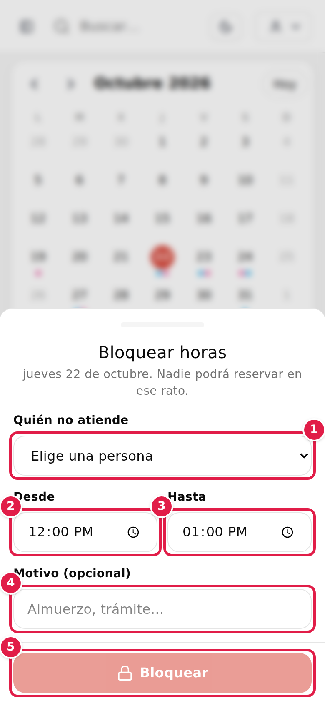

> 📸 **Captura 47** — Hoja **Bloquear horas**. Elementos a resaltar: 1) **Quién no atiende**, 2) **Desde**, 3) **Hasta**, 4) **Motivo**, 5) botón **Bloquear**. Encuadre: pantalla completa del móvil. Nombre de archivo sugerido: `47_bloquear_horas.png`

1. Elige el día en el calendario.
2. Pulsa los tres puntos, arriba a la derecha de la lista.
3. Pulsa **Bloquear horas**.
4. Elige quién no atiende (número 1). Si hay un solo profesional, ya viene elegido.
5. Escribe la hora **Desde** (número 2) y **Hasta** (número 3).
6. Escribe un **Motivo** si quieres, por ejemplo *Almuerzo* (número 4).
7. Pulsa **Bloquear** (número 5).

✅ **Resultado esperado:** Ves el aviso *Horas bloqueadas*. En la lista del día aparece **Bloqueado**, con un candado.

> ❓ **Nota:** Para quitar un bloqueo o cerrar días enteros, mira el [capítulo 12](#12-profesionales) (**Ausencias**) y el [capítulo 13](#13-configuración) (**Cierres**).

> ⚠️ **Atención:** Si ya hay citas en esas horas, Afilao te avisa. Reprográmalas primero.

## Copiar las horas libres para un cliente

Un cliente te escribe por WhatsApp: *¿tienes hueco el jueves?* Responde en dos toques.

1. Elige el día en el calendario.
2. Pulsa los tres puntos, arriba a la derecha de la lista.
3. Pulsa **Copiar horas libres**.
4. Abre WhatsApp y pega el texto.

El texto sale así: *Tu salón: horas libres el jueves 22 de octubre: 09:00, 09:30, 13:00. ¿Cuál te viene bien?*

> ❓ **Nota:** Si tienes varios profesionales, elige a uno en **Todo el equipo** antes. Así copias sus horas, no las de todo el equipo.

## Buscar una cita o un cliente

La lupa de arriba busca de verdad. Escribe al menos dos letras.

1. Toca el campo **Buscar…**, arriba.
2. Escribe el nombre, el teléfono o el correo de un cliente, o el nombre de un servicio.
3. Toca un resultado.

Los resultados salen en dos grupos: **Clientes** y **Citas**. Al tocar un cliente vas a **Clientes**, ya con su nombre escrito. Al tocar una cita vas a su día y se abre.

> ❓ **Nota:** Los profesionales buscan solo entre sus propias citas.

## Conoce la pantalla en el computador

En el computador la agenda tiene más botones.

👉 Mira la **Captura 11**.

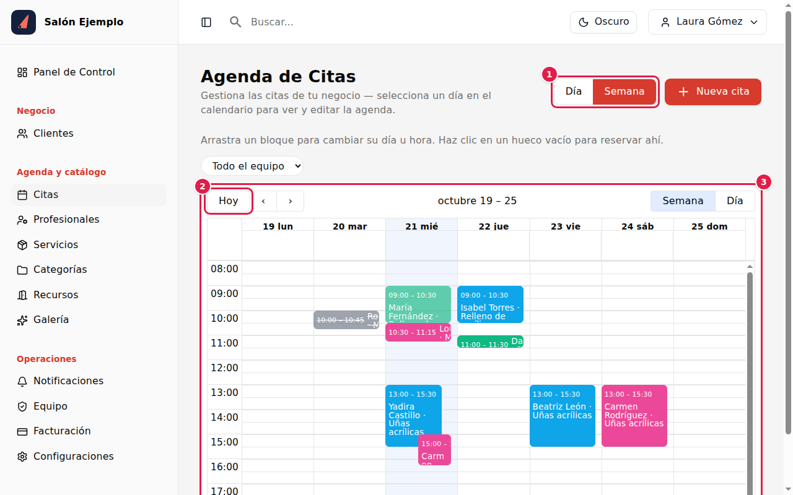

> 📸 **Captura 11** — Vista **Semana** de la agenda en el computador. Elementos a resaltar: 1) botones **Día** y **Semana**, 2) botón **Hoy**, 3) cuadrícula de la semana. Encuadre: pantalla completa. Nombre de archivo sugerido: `11_agenda_semana.png`

1. **Día** (número 1): muestra la lista de citas de un solo día.
2. **Semana**: muestra la semana entera en una cuadrícula.
3. **Hoy** (número 2): vuelve a la semana actual.
4. **Nueva cita**: abre el formulario para crear una cita.

Debajo del calendario hay una leyenda de colores:

| Color | Significa |
|---|---|
| Gris, **No disponible** | El negocio está cerrado ese día. |
| Amarillo, **Completo** | Ya no caben más citas ese día. |
| Punto rojo, **Con citas** | Ese día ya tiene citas. |

### Crear una cita en el computador

Hay dos formas.

**Forma 1: desde un horario libre.** Toca el día en el calendario. Baja hasta **Horarios disponibles**. Elige el servicio y el profesional. Toca el horario libre que quieres.

**Forma 2: con el botón Nueva cita.** Pulsa **Nueva cita** y completa el formulario.

👉 Mira la **Captura 9**.

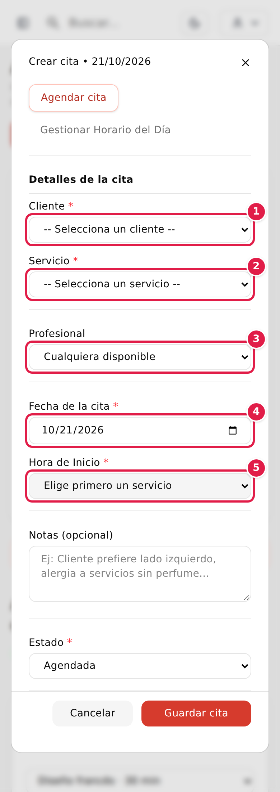

> 📸 **Captura 9** — Formulario **Crear cita**. Elementos a resaltar: 1) **Cliente**, 2) **Servicio**, 3) **Profesional**, 4) **Fecha de la cita**, 5) **Hora de Inicio**. Encuadre: formulario completo. Nombre de archivo sugerido: `09_formulario_cita.png`

1. En **Cliente**, elige a tu cliente (número 1).
2. En **Servicio**, elige el servicio (número 2).
3. En **Profesional**, elige a quien atenderá (número 3). **Cualquiera disponible** deja que Afilao elija.
4. Revisa la **Fecha de la cita** (número 4).
5. En **Hora de Inicio**, elige una hora libre (número 5).
6. Escribe lo que necesites en **Notas (opcional)**.
7. Pulsa **Guardar cita**.

✅ **Resultado esperado:** Ves el aviso *Se creó la cita*. La cita aparece en la lista **Citas programadas**.

> ❓ **Nota:** La lista **Hora de Inicio** dice **Elige primero un servicio** hasta que eliges el servicio. Hazlo en ese orden.

### Los botones de cada cita en el computador

Cada cita tiene una tarjeta con botones: **Confirmar**, **Completar**, **No asistió**, **Cancelar** y **Editar cita**. Funcionan igual que en la hoja del celular, con la misma opción de **Deshacer**.

### ⚠️ Si algo sale mal

| Ves este mensaje | Qué hacer |
|---|---|
| *Esa hora ya no está disponible. Elige otra.* | Otra persona ocupó esa hora. Elige otra hora de la lista. |
| *Este día no está disponible para agendar* | El negocio está cerrado ese día. Elige otro día. |
| *Por favor completa todos los campos requeridos* | Falta un campo con asterisco rojo. Complétalo. |
| No sale ninguna hora en la lista. | Ese profesional no trabaja ese día o ya tiene todo ocupado. Prueba con otro día. |

## Cambiar el día o la hora de una cita

1. Toca la cita (en el celular) o busca su tarjeta (en el computador).
2. Pulsa **Editar cita**.
3. Cambia la **Fecha de la cita** o la **Hora de Inicio**.
4. Pulsa **Guardar cita**.

✅ **Resultado esperado:** Ves el aviso *Se actualizó la cita*. El cliente recibe el aviso del cambio.

### Arrastrar una cita en el computador

En la vista **Semana** puedes mover una cita con el ratón.

👉 Mira la **Captura 11**.

> 📸 **Captura 11** — Vista **Semana** de la agenda en el computador. Elementos a resaltar: 1) botones **Día** y **Semana**, 2) botón **Hoy**, 3) cuadrícula de la semana. Encuadre: pantalla completa. Nombre de archivo sugerido: `11_agenda_semana.png`

1. Pulsa **Semana** (número 1).
2. Mantén pulsado el bloque de la cita.
3. Arrástralo al día y la hora nuevos.
4. Suéltalo.

✅ **Resultado esperado:** La cita aparece en su lugar nuevo. Ves el aviso *Se actualizó la cita*.

💡 **Consejo:** Pulsa **Hoy** (número 2) para volver a la semana actual. Usa las flechas **‹** y **›** para cambiar de semana.

💡 **Consejo:** Haz clic en un hueco vacío de la cuadrícula para crear una cita en esa hora.

## Cambiar el horario de un solo día

Quizás un día cierras antes o abres más tarde. Puedes cambiar solo ese día, sin tocar tu horario normal.

1. Toca el día en el calendario.
2. En el celular, pulsa los tres puntos y luego **Gestionar horario de este día**. En el computador, pulsa **Gestionar Horario de este Día**.
3. Mira el recuadro **Horario General** o **Horario Personalizado**.
4. En **Horarios disponibles para este día**, escribe una hora, por ejemplo `10:00`.
5. Pulsa **+ Agregar**. Repite para cada hora.
6. Pulsa **Guardar Excepción**.

✅ **Resultado esperado:** Ves el aviso *Excepción de horario guardada correctamente*.

Para volver al horario normal, pulsa **Restaurar Horario Normal**. Verás *Horario restaurado al estado normal*.

> ❓ **Nota:** Para cerrar días completos, como vacaciones o feriados, usa **Configuraciones › Cierres**. Mira el [capítulo 13](#13-configuración).

## Si eres profesional

Tú ves solo tus citas. No ves el filtro **Todo el equipo**. Puedes confirmar, completar y marcar **No asistió** en tus citas. Tu buscador también busca solo entre tus citas.

### ⚠️ Errores frecuentes

| Qué pasa | Qué hacer |
|---|---|
| No encuentro una cita. | Revisa el día en el calendario. Si eres dueño, mira el filtro **Todo el equipo**. |
| Cancelé una cita por error. | Si fue hace menos de 5 segundos, pulsa **Deshacer**. Si no, pulsa **Editar cita**, cambia **Estado** a **Agendada** y pulsa **Guardar cita**. Si la hora ya se ocupó, crea una cita nueva. |
| El día sale **Completo** pero quedan huecos. | Tu negocio tiene un límite de citas por día. Cámbialo en **Configuraciones › Horarios**. |

---

# 8. Clientes

## Qué puedes hacer aquí

En **Clientes** guardas los datos de las personas que te visitan. Los buscas, los editas y los borras.

**Menú › Clientes** (lo ven el dueño y el gerente)

> ❓ **Nota:** Cuando alguien reserva por tu página, Afilao crea su ficha solo. No tienes que hacer nada.

## Conoce la pantalla

👉 Mira la **Captura 12**.

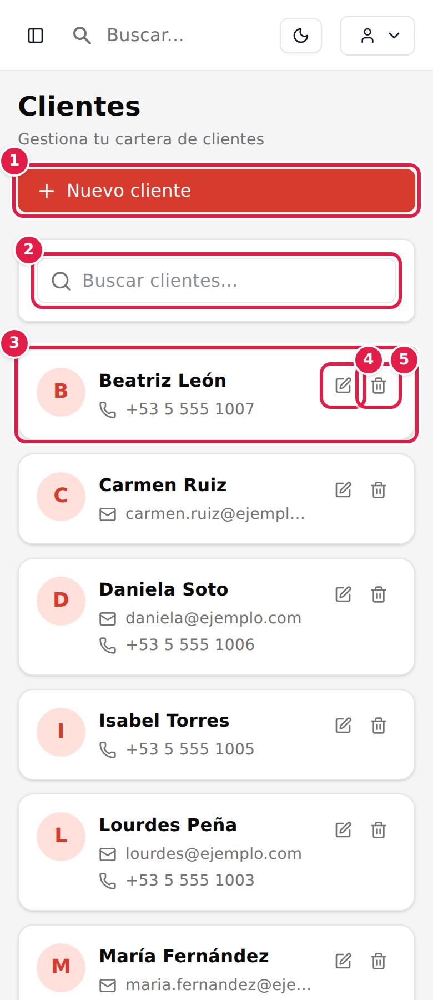

> 📸 **Captura 12** — Pantalla **Clientes**. Elementos a resaltar: 1) botón **Nuevo cliente**, 2) buscador, 3) tarjeta de un cliente, 4) icono de lápiz, 5) icono de papelera. Encuadre: pantalla completa del móvil. Nombre de archivo sugerido: `12_clientes_lista.png`

1. **Nuevo cliente** (número 1): crea una ficha.
2. Buscador (número 2): escribe un nombre, un correo o un teléfono.
3. Tarjeta (número 3): muestra el nombre, el correo y el teléfono.
4. Lápiz (número 4): edita la ficha.
5. Papelera (número 5): borra la ficha.

## Dar de alta a un cliente

👉 Mira la **Captura 13**.

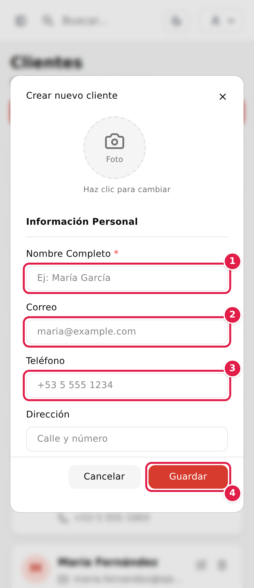

> 📸 **Captura 13** — Formulario **Crear nuevo cliente**. Elementos a resaltar: 1) **Nombre Completo**, 2) **Correo**, 3) **Teléfono**, 4) botón **Guardar**. Encuadre: formulario completo. Nombre de archivo sugerido: `13_cliente_formulario.png`

1. Pulsa **Nuevo cliente**.
2. Escribe el nombre en **Nombre Completo** (número 1).
3. Escribe el **Correo** (número 2), si lo tiene.
4. Escribe el **Teléfono** (número 3), si lo tiene.
5. Si quieres, escribe la **Dirección**.
6. Pulsa **Guardar** (número 4).

✅ **Resultado esperado:** Ves el aviso *Se creó el cliente*. La ficha aparece en la lista.

> ⚠️ **Atención:** Necesitas al menos un teléfono o un correo. Con los dos, mejor.

💡 **Consejo:** Para añadir una foto, toca el círculo **Foto** al inicio del formulario.

## Buscar a un cliente

1. Pulsa **Clientes** en el menú.
2. Toca el buscador **Buscar clientes...**.
3. Escribe una parte del nombre, del correo o del teléfono.

✅ **Resultado esperado:** La lista muestra solo los clientes que coinciden.

## Editar a un cliente

1. Busca la tarjeta del cliente.
2. Toca el icono del lápiz.
3. Cambia lo que necesites.
4. Pulsa **Guardar**.

✅ **Resultado esperado:** Ves el aviso *Se actualizó el cliente*.

## Borrar a un cliente

1. Busca la tarjeta del cliente.
2. Toca el icono de la papelera.
3. Lee la pregunta: *¿Estás seguro de que quieres eliminar el cliente? Esta acción no se puede deshacer.*
4. Pulsa **Eliminar**.

✅ **Resultado esperado:** Ves el aviso *Se eliminó el cliente*.

> ⚠️ **Atención:** Borrar no se puede deshacer. Afilao no te deja borrar a un cliente que tiene citas, ni siquiera canceladas. Así no pierdes tu historial.

### ⚠️ Si algo sale mal

| Ves este mensaje | Qué hacer |
|---|---|
| *Indica un teléfono o un correo* | Escribe al menos uno de los dos y guarda de nuevo. |
| *Ya existe un cliente con ese teléfono* | Ese cliente ya está guardado. Búscalo en la lista. |
| *Ya existe un cliente con ese correo* | Ese cliente ya está guardado. Búscalo en la lista. |
| *Este cliente tiene 2 citas registradas. Para no perder tu historial, no se puede eliminar.* | El cliente tiene citas en su historial. Déjalo guardado. |

---

# 9. Tu página de reserva

## Qué puedes hacer aquí

Tus clientes reservan solos en una página web tuya. Aquí sacas el enlace, imprimes el cartel con QR y ajustas las reglas de reserva.

**Menú › Configuraciones › Reservas**

## Saca tu enlace y tu código QR

👉 Mira la **Captura 14**.

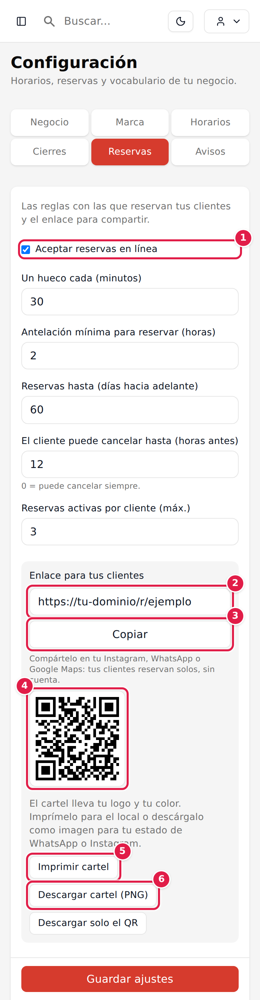

> 📸 **Captura 14** — Ficha **Reservas** de **Configuraciones**. Elementos a resaltar: 1) **Aceptar reservas en línea**, 2) enlace, 3) botón **Copiar**, 4) código QR, 5) **Imprimir cartel**, 6) **Descargar cartel (PNG)**. Encuadre: pantalla completa del móvil. Nombre de archivo sugerido: `14_reservas_enlace_qr.png`

1. Pulsa **Configuraciones** en el menú.
2. Pulsa la ficha **Reservas**.
3. Mira que **Aceptar reservas en línea** esté marcado (número 1).
4. Baja hasta **Enlace para tus clientes** (número 2).
5. Pulsa **Copiar** (número 3).

✅ **Resultado esperado:** Ves el aviso *Enlace copiado*.

Ahora pega el enlace donde quieras: tu Instagram, tu WhatsApp o tu ubicación en Google Maps.

> ⚠️ **Atención:** Si quitas la marca de **Aceptar reservas en línea** y guardas, tus clientes ven este mensaje: *Este negocio no acepta reservas en línea por ahora.*

## Imprime tu cartel

El cartel lleva tu logo, tu color y el código QR. Tus clientes lo escanean con la cámara del celular.

👉 Mira la **Captura 15**.

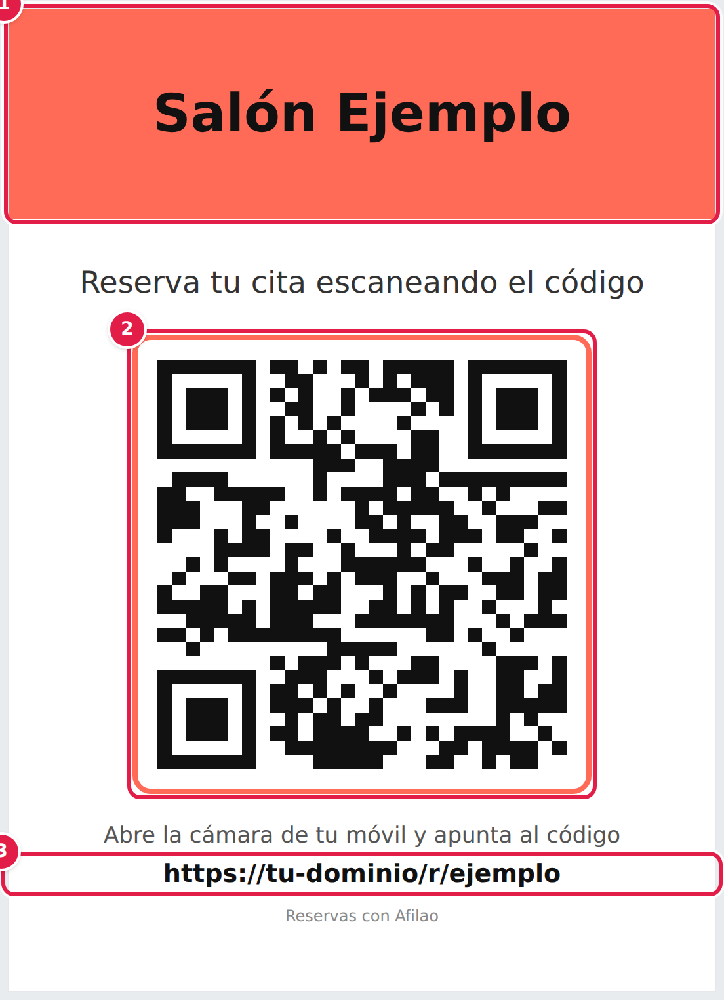

> 📸 **Captura 15** — Cartel con el código QR para imprimir. Elementos a resaltar: 1) nombre o logo de tu salón, 2) código QR, 3) enlace de reserva. Encuadre: cartel completo. Nombre de archivo sugerido: `15_cartel_qr.png`

1. En la ficha **Reservas**, baja hasta el código QR.
2. Elige una opción:
   - **Imprimir cartel**: lo manda a la impresora.
   - **Descargar cartel (PNG)**: guarda una imagen para compartir en WhatsApp o Instagram.
   - **Descargar solo el QR**: guarda solo el código.

✅ **Resultado esperado:** Se abre la ventana de impresión, o se guarda la imagen en tu dispositivo.

> ❓ **Nota:** El cartel se ve así de bien si ya subiste tu logo y elegiste tu color. Lo haces en **Configuraciones › Marca**. Mira el [capítulo 13](#13-configuración).

### ⚠️ Si algo sale mal

| Ves este mensaje | Qué hacer |
|---|---|
| *Permite las ventanas emergentes para imprimir el cartel* | Tu navegador bloqueó la ventana. Permítela y pulsa **Imprimir cartel** otra vez. |
| *No se pudo crear la imagen* | Pulsa **Descargar cartel (PNG)** otra vez. Si falla, prueba **Imprimir cartel**. |

## Ajusta las reglas de reserva

En la misma ficha **Reservas** tienes estos campos:

| Campo | Qué controla |
|---|---|
| **Un hueco cada (minutos)** | Cada cuántos minutos se ofrece una hora. Por ejemplo, 30 ofrece 09:00, 09:30, 10:00. |
| **Antelación mínima para reservar (horas)** | Con cuántas horas de aviso pueden reservar. Con 2, nadie reserva para dentro de una hora. |
| **Reservas hasta (días hacia adelante)** | Hasta cuántos días en el futuro pueden reservar. |
| **El cliente puede cancelar hasta (horas antes)** | Hasta cuándo puede cancelar o cambiar su cita. Con 0, siempre. |
| **Reservas activas por cliente (máx.)** | Cuántas citas pendientes puede tener a la vez una misma persona. |

Para guardar los cambios:

1. Cambia lo que necesites.
2. Pulsa **Guardar ajustes**, abajo.

✅ **Resultado esperado:** Ves el aviso *Ajustes de reserva guardados*.

## Lo que ve tu cliente

Esto es lo que verá tu cliente cuando abra tu enlace. Conócelo para ayudarle si te llama.

### Paso 1: elige el servicio

👉 Mira la **Captura 16**.

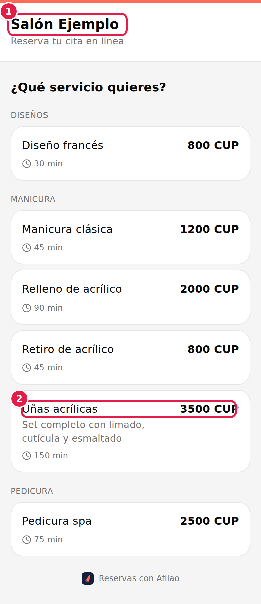

> 📸 **Captura 16** — Página de reserva, primer paso. Elementos a resaltar: 1) nombre del salón, 2) un servicio con su precio y duración. Encuadre: pantalla completa del móvil. Nombre de archivo sugerido: `16_reserva_servicios.png`

El cliente ve la pregunta **¿Qué servicio quieres?** con tus servicios agrupados por categoría. Toca el que quiere.

### Paso 2: elige con quién (si hay varios profesionales)

👉 Mira la **Captura 17**.

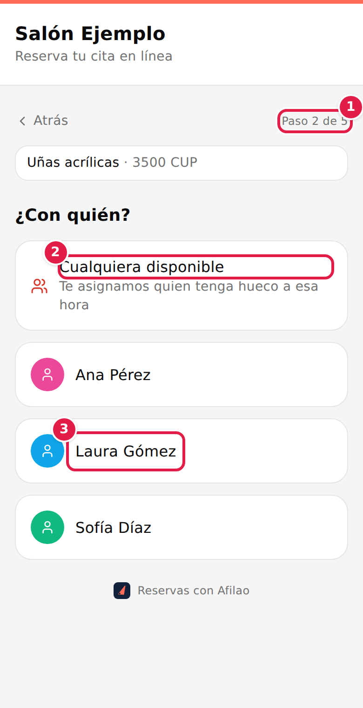

> 📸 **Captura 17** — Página de reserva, paso **¿Con quién?**. Elementos a resaltar: 1) indicador de paso, 2) **Cualquiera disponible**, 3) un profesional. Encuadre: pantalla completa del móvil. Nombre de archivo sugerido: `17_reserva_profesional.png`

Si ofreces el servicio con varias personas, el cliente elige una o toca **Cualquiera disponible**. Arriba ve **Paso 2 de 5** y el servicio que eligió.

### Paso 3: elige el día

👉 Mira la **Captura 18**.

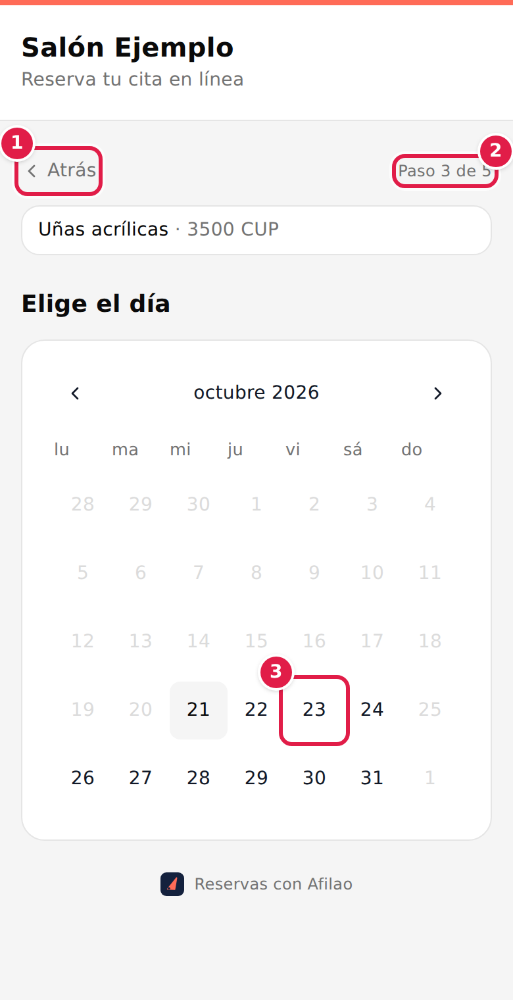

> 📸 **Captura 18** — Página de reserva, paso **Elige el día**. Elementos a resaltar: 1) botón **Atrás**, 2) indicador de paso, 3) un día disponible. Encuadre: pantalla completa del móvil. Nombre de archivo sugerido: `18_reserva_dia.png`

Los días que no se pueden elegir salen en gris. El botón **Atrás** vuelve al paso anterior.

### Paso 4: elige la hora

👉 Mira la **Captura 19**.

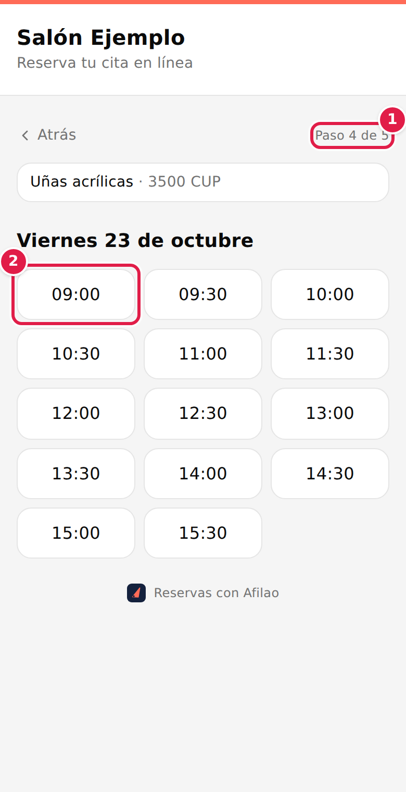

> 📸 **Captura 19** — Página de reserva, paso de la hora. Elementos a resaltar: 1) indicador de paso, 2) una hora libre. Encuadre: pantalla completa del móvil. Nombre de archivo sugerido: `19_reserva_hora.png`

El cliente toca la hora que le sirve. Solo ve horas libres.

### Paso 5: escribe sus datos

👉 Mira la **Captura 20**.

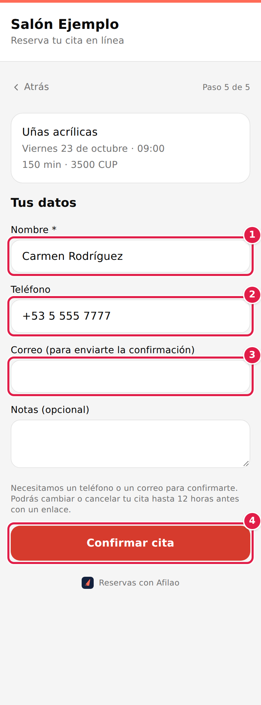

> 📸 **Captura 20** — Página de reserva, paso **Tus datos**. Elementos a resaltar: 1) **Nombre**, 2) **Teléfono**, 3) **Correo**, 4) botón **Confirmar cita**. Encuadre: pantalla completa del móvil. Nombre de archivo sugerido: `20_reserva_datos.png`

El cliente escribe su nombre y un teléfono o un correo. Luego toca **Confirmar cita**.

### Listo: la reserva está hecha

👉 Mira la **Captura 21**.

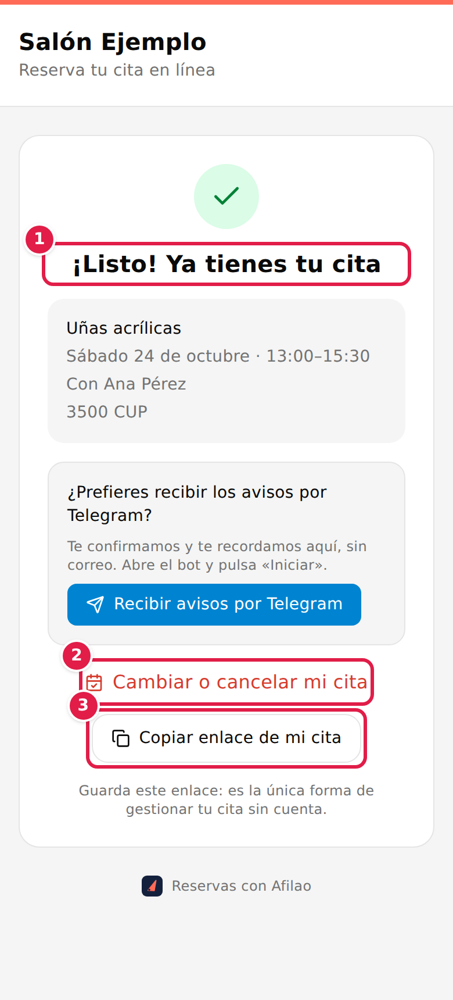

> 📸 **Captura 21** — Página de reserva confirmada. Elementos a resaltar: 1) mensaje **¡Listo! Ya tienes tu cita**, 2) enlace **Cambiar o cancelar mi cita**, 3) botón **Copiar enlace de mi cita**. Encuadre: pantalla completa del móvil. Nombre de archivo sugerido: `21_reserva_listo.png`

El cliente ve **¡Listo! Ya tienes tu cita** con el resumen. Si tu negocio tiene el bot de Telegram (un asistente automático que manda avisos; lo explicamos en el [capítulo 10](#10-el-bot-de-telegram)), ve también el botón **Recibir avisos por Telegram**.

Debajo del resumen, el cliente ve **Añadir a mi calendario**. Tiene dos botones: **Google Calendar** y **Apple / Outlook (.ics)**. Con uno de ellos, la cita queda en su calendario con la fecha, la hora y el nombre del salón. Así no se le olvida.

> ⚠️ **Atención:** Dile a tus clientes que guarden el enlace **Cambiar o cancelar mi cita**. Es la única forma de gestionar su cita sin cuenta. Para eso sirve **Copiar enlace de mi cita**.

### Cambiar o cancelar su cita

👉 Mira la **Captura 22**.

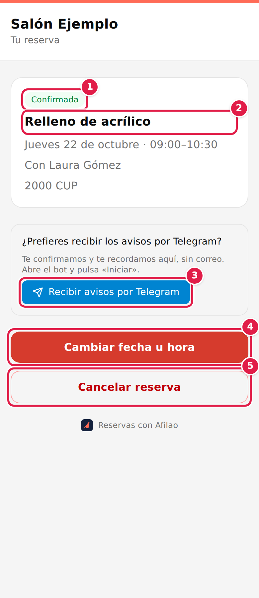

> 📸 **Captura 22** — Página **Tu reserva**. Elementos a resaltar: 1) estado, 2) resumen de la cita, 3) **Recibir avisos por Telegram**, 4) **Cambiar fecha u hora**, 5) **Cancelar reserva**. Encuadre: pantalla completa del móvil. Nombre de archivo sugerido: `22_gestionar_cita.png`

Con su enlace, el cliente toca **Cambiar fecha u hora** o **Cancelar reserva**. Tú ves el cambio en tu agenda al instante. Mientras la cita esté activa, también puede **Añadir a mi calendario**.

👉 Mira la **Captura 49**.

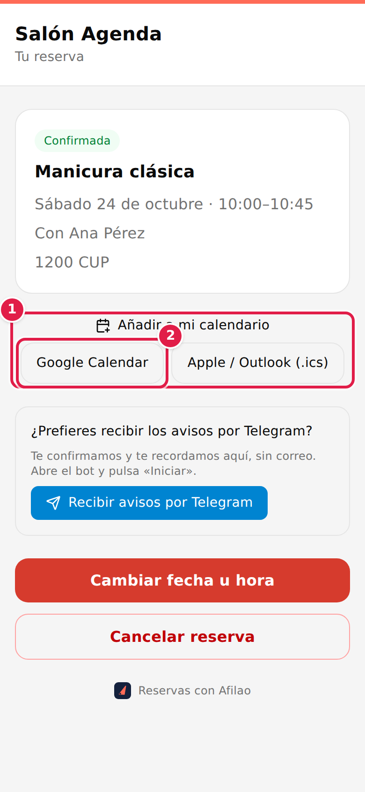

> 📸 **Captura 49** — Página **Tu reserva** con **Añadir a mi calendario**. Elementos a resaltar: 1) grupo **Añadir a mi calendario**, 2) botón **Google Calendar**. Encuadre: pantalla completa del móvil. Nombre de archivo sugerido: `49_anadir_calendario.png`

### ⚠️ Lo que puede ver tu cliente cuando algo falla

| Mensaje | Qué significa |
|---|---|
| *El horario seleccionado ya no está disponible. Elige otro.* | Otra persona reservó esa hora un segundo antes. Debe elegir otra. |
| *Ya tienes 3 reservas pendientes. Cancela alguna o contacta al salón para reservar más.* | Llegó al máximo de citas activas por cliente. |
| *Solo se puede cambiar con al menos 12 horas de antelación. Contacta al salón.* | Pasó el plazo para cancelar. Debe llamarte. |
| *Enlace no válido o vencido* | El enlace de su cita ya no sirve. Búscala en tu agenda. |

---

# 10. El bot de Telegram

## Qué puedes hacer aquí

Con el bot de Telegram, Afilao te avisa de cada reserva nueva o cancelada. También avisa a tus clientes y a tus profesionales. Es opcional, pero muy útil.

Telegram es una aplicación de mensajes, como WhatsApp. Es gratuita. Un bot es un asistente automático que escribe mensajes por ti.

> ❓ **Nota:** Cada negocio crea su propio bot. Así los avisos salen con el nombre de tu salón.

## Qué avisos manda el bot

| A quién | Qué recibe |
|---|---|
| **Dueño** | Cada reserva nueva y cada cancelación del salón. Y cada mañana, a las 8:00, el resumen de las citas del día. |
| **Profesional** | Las reservas nuevas y las cancelaciones de sus propias citas. Y cada mañana, a las 8:00, el resumen de sus citas del día. |
| **Cliente** | Su confirmación y recordatorios de su cita. |

Si un cliente no usa Telegram, recibe los avisos por correo.

### El resumen del día

Cada mañana, a las 8:00 de la hora de tu salón, el bot te escribe con las citas de hoy. Por ejemplo:

> ☀️ Tu salón: 2 citas hoy, jueves 22 de octubre
>
> • 09:00 · María Fernández · Uñas acrílicas (Ana)
> • 11:00 · Yadira Castillo · Manicura clásica (Luis) — pendiente de confirmar

El profesional recibe el suyo con solo sus citas. Si no hay citas ese día, el bot no escribe. Los resúmenes llegan una sola vez por día.

Para apagarlo, ve a **Configuraciones › Avisos** y quita la marca de **Resumen del día por Telegram, cada mañana a las 8:00**. Pulsa **Guardar ajustes**.

## Crear el bot de tu salón

Solo lo hace el dueño, una vez.

1. Abre Telegram en tu celular.
2. Busca **@BotFather** y ábrelo. Es el bot oficial de Telegram para crear bots.
3. Escríbele `/newbot`.
4. Responde lo que te pida: un nombre para el bot y un usuario que termine en `bot`.
5. Copia el **token** que te da. Es un texto largo con números y letras. Es la llave de tu bot.
6. En Afilao, ve a **Menú › Configuraciones › Avisos**.
7. Pega el token en **Token del bot de Telegram (opcional)**.
8. Pulsa **Guardar ajustes**.

👉 Mira la **Captura 23**.

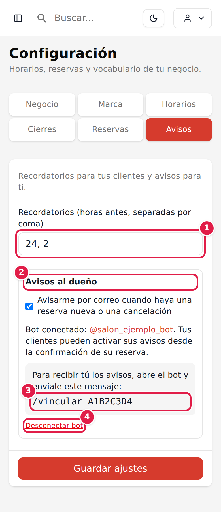

> 📸 **Captura 23** — Ficha **Avisos** de **Configuraciones** con el bot ya conectado. Elementos a resaltar: 1) **Recordatorios**, 2) **Avisos al dueño**, 3) **Resumen del día por Telegram**, 4) código `/vincular`. Encuadre: pantalla completa del móvil. Nombre de archivo sugerido: `23_avisos_telegram.png`

✅ **Resultado esperado:** Ves **Bot conectado: @el_nombre_de_tu_bot**.

> ⚠️ **Atención:** No compartas el token con nadie. Quien lo tenga controla tu bot.

💡 **Consejo:** Pon el logo de tu salón al bot. En Telegram, abre **@BotFather**, elige tu bot, pulsa **Edit Bot** y luego **Edit Botpic**.

### ⚠️ Si algo sale mal

| Ves este mensaje | Qué hacer |
|---|---|
| *Telegram no reconoce ese token. Cópialo de nuevo desde @BotFather.* | Copia el token completo, sin espacios, y pégalo otra vez. |
| *No se pudo activar el bot* | Espera unos minutos y vuelve a guardar. Si sigue, escribe a soporte. |

## Recibir los avisos tú, el dueño

1. En **Configuraciones › Avisos**, busca el recuadro **Avisos al dueño**.
2. Copia el mensaje que dice `/vincular` y un código (número 4 de la Captura 23).
3. Abre tu bot en Telegram. Pulsa su nombre, que aparece como **Bot conectado: @…**.
4. Pulsa **Iniciar** si Telegram te lo pide.
5. Envía el mensaje, por ejemplo `/vincular A1B2C3D4`.

👉 Mira la **Captura 24**.

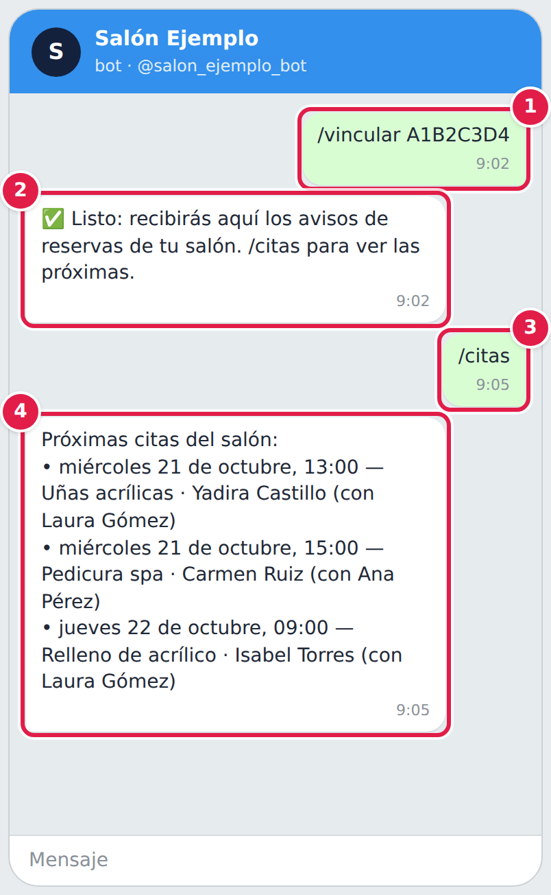

> 📸 **Captura 24** — Chat con el bot de tu salón en Telegram. Elementos a resaltar: 1) tu mensaje con el código, 2) respuesta del bot, 3) comando `/citas`, 4) lista de próximas citas. Encuadre: chat completo en el móvil. Nombre de archivo sugerido: `24_telegram_chat.png`

✅ **Resultado esperado:** El bot responde *✅ Listo: recibirás aquí los avisos de reservas de tu salón.* En Afilao ves *✓ Recibes aquí los avisos de reservas y cancelaciones.*

> ❓ **Nota:** El código sirve una sola vez. Si te equivocas, recarga la página: Afilao te muestra un código nuevo.

## Comandos del bot

Escribe estos comandos en el chat con el bot.

| Comando | Qué hace |
|---|---|
| `/citas` | Dueño: las próximas citas de todo el salón. Profesional: sus próximas citas. Cliente: sus citas, con el enlace para gestionarlas. |
| `/historial` | Cliente: sus últimos trabajos realizados. |
| `/parar` | Deja de enviarte avisos. |
| `/vincular` y un código | Une tu chat con tu cuenta, como dueño o profesional. |

Si escribes otra cosa, el bot responde con una pequeña ayuda y la lista de comandos.

## Vincular a un profesional

Cada profesional vincula su propio Telegram.

1. El profesional entra a Afilao con su cuenta.
2. Pulsa el icono de persona, arriba a la derecha, y luego **Mi Perfil**.
3. Baja hasta **Avisos de mis citas por Telegram**.

👉 Mira la **Captura 25**.

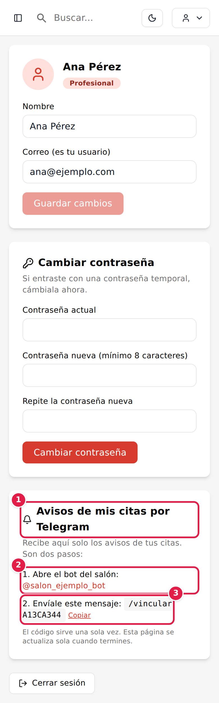

> 📸 **Captura 25** — **Mi perfil** de un profesional, sección **Avisos de mis citas por Telegram**. Elementos a resaltar: 1) título de la sección, 2) enlace al bot del salón, 3) código `/vincular`. Encuadre: recorte de la sección. Nombre de archivo sugerido: `25_perfil_telegram.png`

4. Abre el bot del salón con el enlace que aparece (número 2).
5. Envía el mensaje `/vincular` con su código (número 3).

✅ **Resultado esperado:** El bot responde con tu nombre: *✅ Listo, Ana Pérez: recibirás aquí los avisos de tus citas…* La pantalla de Afilao se actualiza sola.

Para dejar de recibir avisos, el profesional pulsa **Desvincular Telegram** en la misma sección. Verá *Telegram desvinculado*.

> ❓ **Nota:** Si el bot no está conectado, el profesional ve: *El salón todavía no activó el bot de Telegram. Pídele al dueño que lo conecte en Configuraciones.*

## Desconectar el bot

1. Ve a **Menú › Configuraciones › Avisos**.
2. Pulsa **Desconectar bot**.
3. Confirma en el mensaje: *¿Desconectar el bot? Los clientes dejarán de recibir avisos por Telegram.*

✅ **Resultado esperado:** Vuelve a aparecer el campo **Token del bot de Telegram (opcional)**.

> ⚠️ **Atención:** Al desconectar, todos pierden sus avisos por Telegram. Tendrán que vincularse de nuevo cuando conectes un bot.

### ⚠️ Errores frecuentes

| Qué pasa | Qué hacer |
|---|---|
| El bot no me responde. | Revisa que escribiste el mensaje exacto, con `/` al inicio. Prueba `/citas`. |
| El bot dice *Código inválido*. | El código ya se usó o está mal copiado. Recarga Afilao y copia el código nuevo. |
| Un cliente no recibe avisos por Telegram. | Debe tocar **Recibir avisos por Telegram** al confirmar su reserva. Si no, recibe correo. |

---

# 11. Servicios y Categorías

## Qué puedes hacer aquí

En **Servicios** pones lo que ofreces, con su precio y su duración. En **Categorías** los agrupas, para que tus clientes los encuentren fácil.

**Menú › Servicios** y **Menú › Categorías** (los ven el dueño y el gerente)

## Conoce la pantalla de Servicios

👉 Mira la **Captura 26**.

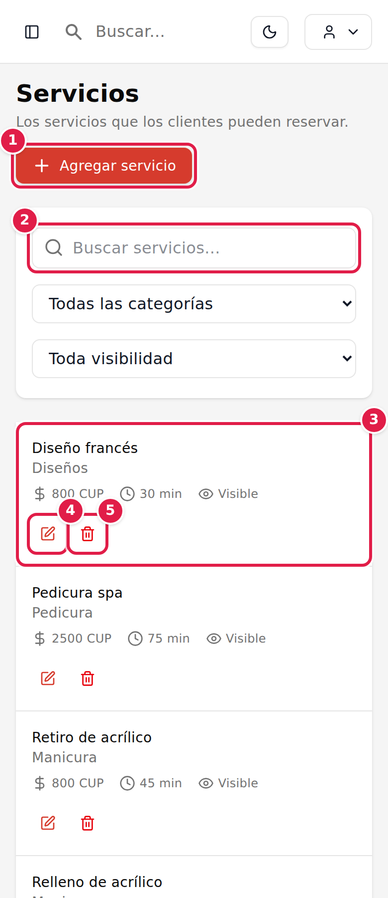

> 📸 **Captura 26** — Pantalla **Servicios**. Elementos a resaltar: 1) botón **Agregar servicio**, 2) buscador, 3) fila de un servicio, 4) icono de lápiz, 5) icono de papelera. Encuadre: pantalla completa del móvil. Nombre de archivo sugerido: `26_servicios_lista.png`

1. **Agregar servicio** (número 1): crea un servicio nuevo.
2. Buscador (número 2): escribe una parte del nombre. Debajo tienes dos filtros: **Todas las categorías** y **Toda visibilidad**.
3. Fila del servicio (número 3): muestra el nombre, la categoría, el precio, la duración y si es **Visible**.
4. Lápiz (número 4): edita el servicio.
5. Papelera (número 5): borra el servicio.

## Crear un servicio

👉 Mira la **Captura 27**.

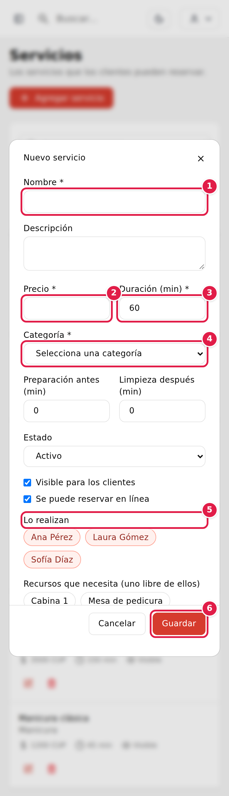

> 📸 **Captura 27** — Formulario **Nuevo servicio**. Elementos a resaltar: 1) **Nombre**, 2) **Precio**, 3) **Duración (min)**, 4) **Categoría**, 5) **Lo realizan**, 6) botón **Guardar**. Encuadre: formulario completo. Nombre de archivo sugerido: `27_servicio_formulario.png`

1. Pulsa **Agregar servicio**.
2. Escribe el nombre en **Nombre** (número 1). Por ejemplo, *Uñas acrílicas*.
3. Escribe el **Precio** (número 2). Solo el número, sin moneda.
4. Escribe la **Duración (min)** (número 3). Por ejemplo, `90`.
5. Elige la **Categoría** (número 4).
6. En **Lo realizan** (número 5), toca los nombres de los profesionales que hacen este servicio. Los elegidos se ponen de color.
7. Pulsa **Guardar** (número 6).

✅ **Resultado esperado:** Ves el aviso *Servicio creado correctamente*. El servicio aparece en la lista.

Estos campos son opcionales:

| Campo | Para qué sirve |
|---|---|
| **Descripción** | Un texto corto que verá tu cliente al reservar. |
| **Preparación antes (min)** | Minutos que necesitas antes de empezar. Ese tiempo queda bloqueado en la agenda. |
| **Limpieza después (min)** | Minutos que necesitas al terminar. También queda bloqueado. |
| **Estado** | **Activo** o **Inactivo (no se puede reservar)**. |
| **Visible para los clientes** | Si quitas la marca, el servicio no sale en tu página de reserva. |
| **Se puede reservar en línea** | Si quitas la marca, solo tú puedes agendarlo desde el panel. |
| **Recursos que necesita** | Silla o cabina que ocupa el servicio. Solo sale si creaste recursos. |

> ⚠️ **Atención:** Si no marcas a ningún profesional en **Lo realizan**, nadie podrá recibir reservas de ese servicio.

💡 **Consejo:** Para quitar un servicio por un tiempo, ponlo en **Inactivo**. Así no pierdes su historial.

## Editar o borrar un servicio

1. Busca el servicio en la lista.
2. Toca el lápiz para editarlo, o la papelera para borrarlo.
3. Si editas, cambia lo que necesites y pulsa **Guardar**. Verás *Servicio actualizado correctamente*.
4. Si borras, confirma la pregunta *¿Seguro que quieres eliminar este servicio?*. Verás *Servicio eliminado correctamente*.

### ⚠️ Si algo sale mal

| Qué pasa | Qué hacer |
|---|---|
| Un servicio no sale en mi página de reserva. | Revisa que esté **Activo**, **Visible para los clientes** y **Se puede reservar en línea**. Revisa también que algún profesional lo haga. |
| No me deja guardar. | Falta el nombre, el precio, la duración o la categoría. |
| No puedo borrar un servicio con citas. | Ponlo en **Inactivo** en lugar de borrarlo. |

## Las categorías

👉 Mira la **Captura 28**.

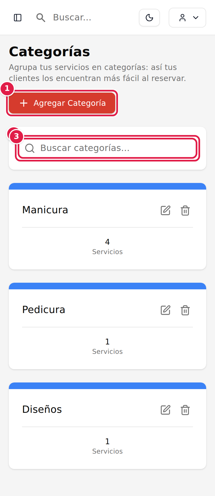

> 📸 **Captura 28** — Pantalla **Categorías**. Elementos a resaltar: 1) botón **Agregar Categoría**, 2) buscador, 3) tarjeta de una categoría. Encuadre: pantalla completa del móvil. Nombre de archivo sugerido: `28_categorias.png`

Cada tarjeta muestra el nombre de la categoría y cuántos servicios tiene. Por ejemplo: **Manicura**, **Pedicura**, **Diseños**.

### Crear una categoría

1. Pulsa **Menú › Categorías**.
2. Pulsa **Agregar Categoría** (número 1).
3. Escribe el **Nombre** (obligatorio).
4. Si quieres, escribe una **Descripción**, elige un **Color** y un **Orden**.
5. Pulsa **Crear Categoría**.

✅ **Resultado esperado:** Ves el aviso *Categoría creada correctamente*.

Para editar, toca el lápiz de la tarjeta, cambia lo que necesites y pulsa **Actualizar Categoría**. Para borrar, toca la papelera y confirma.

> ⚠️ **Atención:** Si una categoría tiene servicios, cámbiales la categoría antes de borrarla.

---

# 12. Profesionales

## Qué puedes hacer aquí

Aquí creas la ficha de cada persona que atiende. Defines cuándo trabaja, qué servicios hace y cómo reserva su agenda.

**Menú › Profesionales** (lo ven el dueño y el gerente)

## Conoce la pantalla

👉 Mira la **Captura 29**.

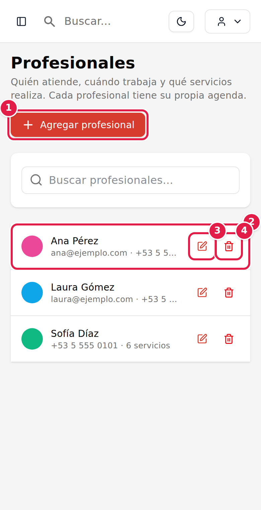

> 📸 **Captura 29** — Pantalla **Profesionales**. Elementos a resaltar: 1) botón **Agregar profesional**, 2) fila de un profesional, 3) icono de lápiz, 4) icono de papelera. Encuadre: pantalla completa del móvil. Nombre de archivo sugerido: `29_profesionales_lista.png`

Cada fila muestra el correo, el teléfono y cuántos servicios hace. También puede decir:

- **con acceso**: tiene una cuenta para entrar a Afilao.
- **por cupos**: reserva por cupos (lo explicamos abajo).
- **sin reserva en línea**: los clientes no pueden elegirlo en tu página.
- **(inactivo)**: ya no trabaja contigo.

## Crear un profesional

1. Pulsa **Agregar profesional**.
2. Escribe el **Nombre**.
3. Elige un **Color en la agenda**. Así lo distingues en la vista **Semana**.
4. Escribe el **Correo** y el **Teléfono**, si quieres.
5. Elige **Cómo recibe reservas**. Lo explicamos en la sección siguiente.
6. Revisa su horario.
7. En **Servicios que realiza**, toca los servicios que hace.
8. Pulsa **Guardar**.

✅ **Resultado esperado:** Ves el aviso *Se creó el profesional*.

Dos casillas importantes:

| Casilla | Qué pasa si la quitas |
|---|---|
| **Activo** | El profesional deja de recibir citas y su cuenta no puede entrar. |
| **Acepta reservas en línea** | Los clientes no lo ven en tu página. Tú sí puedes agendarle citas. |

## Cómo recibe reservas: por hora o por cupos

Cada profesional elige una de estas dos formas.

| Forma | Cómo funciona | Para quién sirve |
|---|---|---|
| **Por hora** | El cliente elige entre las horas libres del horario del profesional. La duración del servicio importa. | La mayoría de los negocios. |
| **Por cupos** | Tú eliges las horas exactas del día. Cada hora es un cupo para un solo cliente. No importa cuánto dure el servicio. | Quien atiende pocos clientes al día. Por ejemplo, a las 9:00 y a las 13:00. |

### Si eliges Por hora

👉 Mira la **Captura 30**.

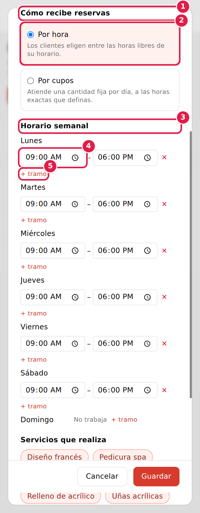

> 📸 **Captura 30** — Formulario de un profesional **Por hora**. Elementos a resaltar: 1) **Cómo recibe reservas**, 2) opción elegida, 3) **Horario semanal**, 4) hora de un tramo, 5) **+ tramo**. Encuadre: recorte del formulario. Nombre de archivo sugerido: `30_profesional_por_hora.png`

1. Marca **Por hora** (número 2).
2. Mira el **Horario semanal** (número 3). Cada día tiene una hora de inicio y una de fin (número 4).
3. Cambia las horas que necesites.
4. Si trabaja un día con descanso, pulsa **+ tramo** (número 5) y añade otro tramo.
5. Para quitar un tramo, pulsa la **×** roja.
6. Un día sin tramos dice **No trabaja**.
7. Pulsa **Guardar**.

### Si eliges Por cupos

👉 Mira la **Captura 31**.

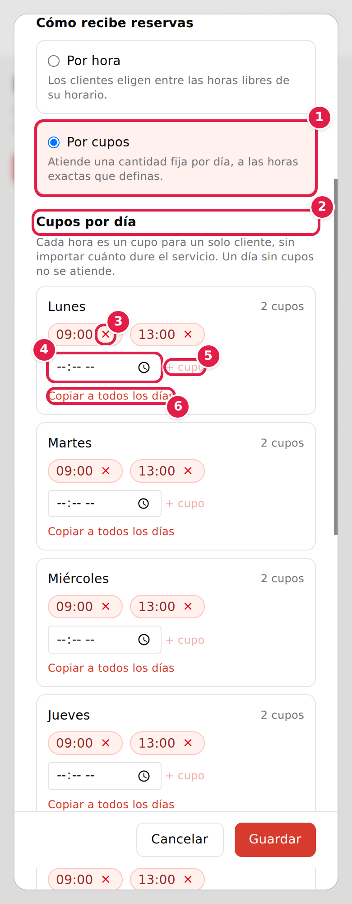

> 📸 **Captura 31** — Formulario de un profesional **Por cupos**. Elementos a resaltar: 1) opción **Por cupos**, 2) **Cupos por día**, 3) **×** de un cupo, 4) campo para una hora nueva, 5) **+ cupo**, 6) **Copiar a todos los días**. Encuadre: recorte del formulario. Nombre de archivo sugerido: `31_profesional_por_cupos.png`

1. Marca **Por cupos** (número 1).
2. Baja hasta **Cupos por día** (número 2). Verás una tarjeta por cada día de la semana.
3. En el día que quieras, elige una hora en el campo de hora (número 4).
4. Pulsa **+ cupo** (número 5).
5. Repite para cada hora. Por ejemplo, `09:00` y `13:00`.
6. Para quitar un cupo, pulsa la **×** de esa hora (número 3).
7. Para usar las mismas horas todos los días, pulsa **Copiar a todos los días** (número 6).
8. Pulsa **Guardar**.

✅ **Resultado esperado:** Cada día muestra cuántos cupos tiene, por ejemplo *2 cupos*. Tus clientes verán solo esas horas.

> ❓ **Nota:** Un día que dice **Sin cupos** no se atiende.

> ⚠️ **Atención:** No puedes quitar un cupo que ya tiene una cita futura. Verás: *No puedes quitar el cupo con una cita futura*, con la fecha. Cambia o cancela esa cita primero.

### ⚠️ Si algo sale mal

| Ves este mensaje | Qué hacer |
|---|---|
| *Hay cupos repetidos el mismo día* | Quitaste o pusiste la misma hora dos veces. Deja cada hora una sola vez. |
| *Hay tramos de horario solapados el mismo día* | Dos tramos se cruzan. Cámbialos para que no coincidan. |
| *Tu plan Basic permite hasta 3 profesionales. Mejora tu plan para añadir más.* | Llegaste al máximo de tu plan. Escribe a soporte. |

## Ausencias: vacaciones y descansos

Si un profesional no estará, registra su ausencia. En esos días nadie podrá reservarle.

👉 Mira la **Captura 32**.

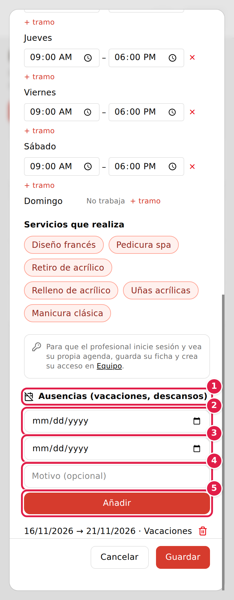

> 📸 **Captura 32** — Sección **Ausencias (vacaciones, descansos)** del formulario de un profesional. Elementos a resaltar: 1) título de la sección, 2) fecha de inicio, 3) fecha de fin, 4) **Motivo (opcional)**, 5) botón **Añadir**. Encuadre: recorte del final del formulario. Nombre de archivo sugerido: `32_profesional_ausencias.png`

1. Toca el lápiz del profesional.
2. Baja hasta **Ausencias (vacaciones, descansos)**.
3. Elige la fecha de inicio (número 2).
4. Elige la fecha de fin (número 3).
5. Escribe el **Motivo (opcional)**, por ejemplo *Vacaciones*.
6. Pulsa **Añadir** (número 5).

✅ **Resultado esperado:** Ves el aviso *Ausencia registrada*. La ausencia aparece en la lista, con la papelera para borrarla.

Si en esas fechas ya hay citas, Afilao te avisa: *¿Registrar la ausencia de todos modos?* Acepta solo si vas a mover esas citas.

> ⚠️ **Atención:** Registrar una ausencia no cancela las citas que ya existen. Reprográmalas tú.

## Editar o borrar a un profesional

1. Toca el lápiz para editar. Cambia lo que necesites y pulsa **Guardar**. Verás *Se actualizó el profesional*.
2. Toca la papelera para borrar. Confirma la pregunta. Verás *Se eliminó el profesional*.

> ⚠️ **Atención:** Si el profesional ya tiene citas, no se puede borrar. Verás: *Este profesional tiene citas registradas. Desactívalo en lugar de eliminarlo.* Quita la marca **Activo** y guarda.

## Dar acceso a un profesional

La ficha del profesional no le da una cuenta para entrar. Para eso, ve a **Equipo**. Mira el [capítulo 14](#14-equipo-y-mi-perfil).

---

# 13. Configuración

## Qué puedes hacer aquí

Aquí ajustas tu negocio: el tipo de negocio, el logo, los horarios y los avisos. Todo está dividido en **seis fichas**, para que no tengas que bajar mucho.

**Menú › Configuraciones** (la ven el dueño y el gerente)

En la parte de arriba hay seis botones. Toca el de la ficha que quieres.

| Ficha | Para qué sirve |
|---|---|
| **Negocio** | Tipo de negocio, zona horaria y vocabulario. |
| **Marca** | Tu logo y tu color. |
| **Horarios** | Los días y horas en que abres. |
| **Cierres** | Días sueltos en que cierras, como feriados. |
| **Reservas** | Reglas de reserva, enlace y cartel con QR. Mira el [capítulo 9](#9-tu-página-de-reserva). |
| **Avisos** | Recordatorios y avisos para ti. Mira el [capítulo 10](#10-el-bot-de-telegram). |

> 💡 **Consejo:** Las fichas **Negocio**, **Reservas** y **Avisos** se guardan juntas con un solo botón **Guardar ajustes**, abajo. Puedes cambiar varias y guardar una sola vez.

## Ficha Negocio

👉 Mira la **Captura 33**.

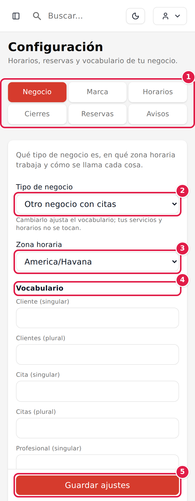

> 📸 **Captura 33** — Ficha **Negocio** de **Configuraciones**. Elementos a resaltar: 1) los seis botones de fichas, 2) **Tipo de negocio**, 3) **Zona horaria**, 4) **Vocabulario**, 5) botón **Guardar ajustes**. Encuadre: pantalla completa del móvil. Nombre de archivo sugerido: `33_config_negocio.png`

1. Pulsa la ficha **Negocio**.
2. Elige tu **Tipo de negocio** (número 2). Hay varios: **Manicura y uñas**, **Barbería**, **Peluquería**, **Spa y masajes**, **Tatuajes**, **Entrenamiento personal** y **Otro negocio con citas**.
3. Revisa la **Zona horaria** (número 3). Para Cuba, es **America/Havana**.
4. En **Vocabulario** (número 4), cambia las palabras si quieres. Por ejemplo, *Citas* por *Turnos*.
5. Pulsa **Guardar ajustes** (número 5).

✅ **Resultado esperado:** Ves el aviso *Ajustes de reserva guardados*.

> ❓ **Nota:** Cambiar el **Tipo de negocio** cambia las palabras del sistema. Tus servicios y horarios no se tocan.

## Ficha Marca

👉 Mira la **Captura 34**.

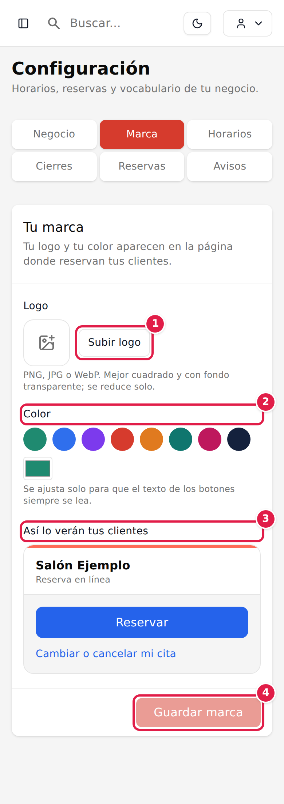

> 📸 **Captura 34** — Ficha **Marca**. Elementos a resaltar: 1) botón **Subir logo**, 2) **Color**, 3) vista previa **Así lo verán tus clientes**, 4) botón **Guardar marca**. Encuadre: pantalla completa del móvil. Nombre de archivo sugerido: `34_config_marca.png`

1. Pulsa la ficha **Marca**.
2. Pulsa **Subir logo** (número 1) y elige la imagen. Sirve PNG, JPG o WebP. Mejor si es cuadrada.
3. Elige un **Color** (número 2). Toca uno de los círculos, o el cuadro del final para elegir otro.
4. Mira la vista previa (número 3). Así verán tus clientes tu página.
5. Pulsa **Guardar marca** (número 4).

✅ **Resultado esperado:** Ves el aviso *Marca guardada*.

> ❓ **Nota:** Tu logo y tu color salen en tu página de reserva, en los correos y en el cartel con QR.

## Ficha Horarios

Aquí dices qué días y a qué horas abre tu negocio. Los clientes no pueden reservar fuera de estas horas.

👉 Mira la **Captura 35**.

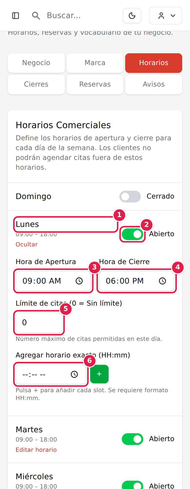

> 📸 **Captura 35** — Ficha **Horarios** con el lunes desplegado. Elementos a resaltar: 1) nombre del día, 2) interruptor **Abierto**, 3) **Hora de Apertura**, 4) **Hora de Cierre**, 5) **Límite de citas**, 6) **Agregar horario exacto**. Encuadre: pantalla completa del móvil. Nombre de archivo sugerido: `35_config_horarios.png`

Cada día aparece resumido, por ejemplo *09:00 – 18:00*. Para cambiarlo:

1. Pulsa la ficha **Horarios**.
2. Busca el día y pulsa **Editar horario**.
3. Cambia la **Hora de Apertura** (número 3) y la **Hora de Cierre** (número 4).
4. Para limitar las citas del día, escribe un número en **Límite de citas (0 = Sin límite)** (número 5).
5. Pulsa **Guardar**.

✅ **Resultado esperado:** Ves el aviso *Horario actualizado correctamente*.

Para abrir o cerrar un día entero, toca el interruptor (número 2). Dice **Abierto** o **Cerrado**. Se guarda al instante.

### Horarios exactos

Si no quieres horas cada 30 minutos, puedes poner horas exactas para un día.

1. Pulsa **Editar horario** en el día.
2. En **Agregar horario exacto (HH:mm)**, elige una hora.
3. Pulsa el botón verde **+**.
4. Repite para cada hora.
5. Pulsa **Guardar**.

> ❓ **Nota:** Cuando un día tiene horarios exactos, tus clientes ven solo esas horas ese día.

### ⚠️ Si algo sale mal

| Ves este mensaje | Qué hacer |
|---|---|
| *La hora de apertura debe ser menor que la de cierre* | Pon una hora de cierre más tarde que la de apertura. |
| *El horario debe tener al menos 1 hora de duración* | Deja al menos una hora entre la apertura y el cierre. |
| *El slot ya existe* | Esa hora exacta ya está en la lista. |

## Ficha Cierres

Usa esta ficha para días sueltos en que no abres: feriados, vacaciones, un evento.

👉 Mira la **Captura 36**.

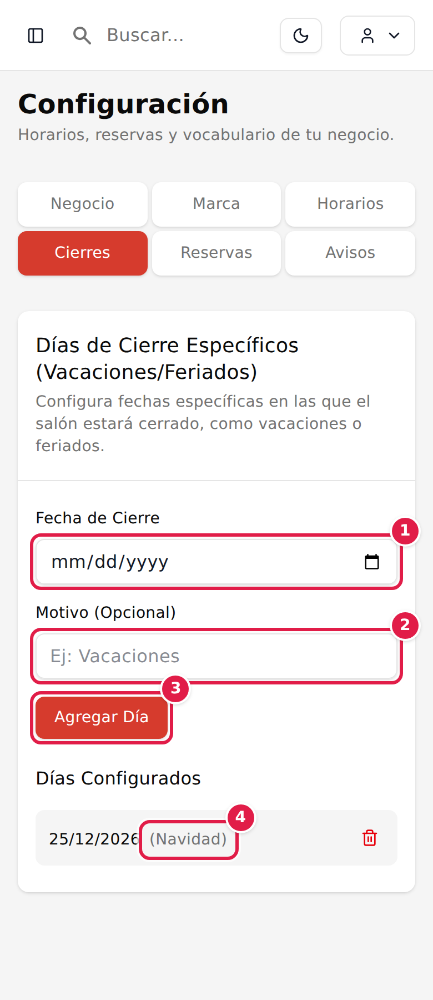

> 📸 **Captura 36** — Ficha **Cierres**. Elementos a resaltar: 1) **Fecha de Cierre**, 2) **Motivo (Opcional)**, 3) botón **Agregar Día**, 4) un día ya configurado. Encuadre: pantalla completa del móvil. Nombre de archivo sugerido: `36_config_cierres.png`

1. Pulsa la ficha **Cierres**.
2. Elige la **Fecha de Cierre** (número 1).
3. Escribe un **Motivo (Opcional)**, por ejemplo *Navidad* (número 2).
4. Pulsa **Agregar Día** (número 3).

✅ **Resultado esperado:** Ves el aviso *Día de cierre agregado correctamente*. El día aparece en **Días Configurados**.

Para quitar un cierre, pulsa la papelera roja de ese día. Verás *Día de cierre eliminado correctamente*.

> ❓ **Nota:** Ese día aparece como **No disponible** en tu calendario, y tus clientes no pueden reservar.

## Ficha Reservas y ficha Avisos

Estas dos fichas se explican en otros capítulos:

- **Reservas**: enlace, cartel con QR y reglas. Mira el [capítulo 9](#9-tu-página-de-reserva).
- **Avisos**: recordatorios, avisos para ti y Telegram. Mira el [capítulo 10](#10-el-bot-de-telegram).

En **Avisos** también tienes el campo **Recordatorios (horas antes, separadas por coma)**. Escribe, por ejemplo, `24, 2`. Tus clientes recibirán un recordatorio 24 horas antes y otro 2 horas antes. También está la casilla **Avisarme por correo cuando haya una reserva nueva o una cancelación**.

---

# 14. Equipo y Mi perfil

## Qué puedes hacer aquí

En **Equipo** el dueño crea las cuentas de las personas que entran a Afilao. En **Mi perfil** cada persona cambia sus propios datos.

**Menú › Equipo** (solo lo ve el dueño)

## Conoce la pantalla de Equipo

👉 Mira la **Captura 37**.

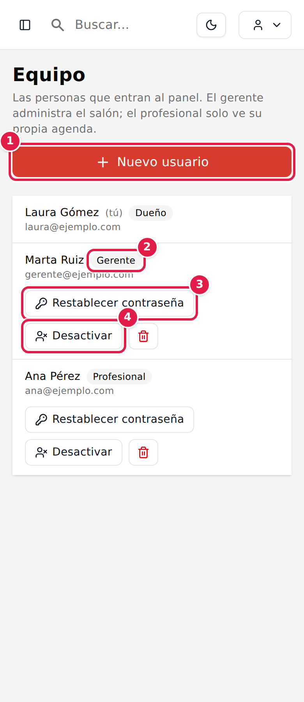

> 📸 **Captura 37** — Pantalla **Equipo**. Elementos a resaltar: 1) botón **Nuevo usuario**, 2) tipo de usuario, 3) botón **Restablecer contraseña**, 4) botón **Desactivar**. Encuadre: pantalla completa del móvil. Nombre de archivo sugerido: `37_equipo_lista.png`

Cada persona muestra su tipo (**Dueño**, **Gerente** o **Profesional**) y su correo. El dueño no se puede cambiar.

## Crear una cuenta

👉 Mira la **Captura 38**.

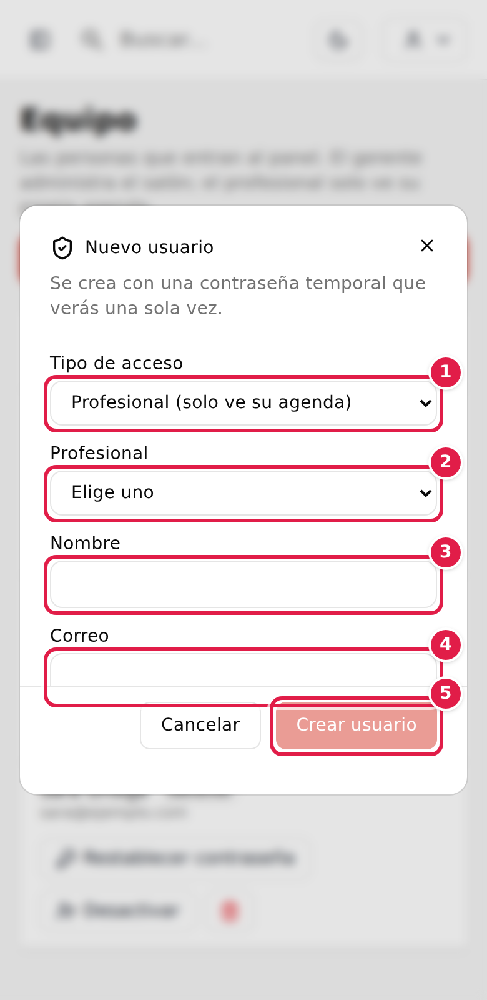

> 📸 **Captura 38** — Formulario **Nuevo usuario**. Elementos a resaltar: 1) **Tipo de acceso**, 2) **Profesional**, 3) **Nombre**, 4) **Correo**, 5) botón **Crear usuario**. Encuadre: formulario completo. Nombre de archivo sugerido: `38_equipo_nuevo.png`

### Para un profesional

Primero crea su ficha en **Profesionales**. Luego:

1. Pulsa **Menú › Equipo**.
2. Pulsa **Nuevo usuario**.
3. En **Tipo de acceso**, deja **Profesional (solo ve su agenda)** (número 1).
4. En **Profesional**, elige su nombre (número 2). Elige **Elige uno** si no sale.
5. Revisa el **Nombre** y el **Correo**. Se llenan solos con los datos de su ficha.
6. Pulsa **Crear usuario**.

### Para un gerente

1. Pulsa **Nuevo usuario**.
2. En **Tipo de acceso**, elige **Gerente (administra el salón)**.
3. Escribe el **Nombre** y el **Correo**.
4. Pulsa **Crear usuario**.

### Entrega los datos de acceso

👉 Mira la **Captura 39**.

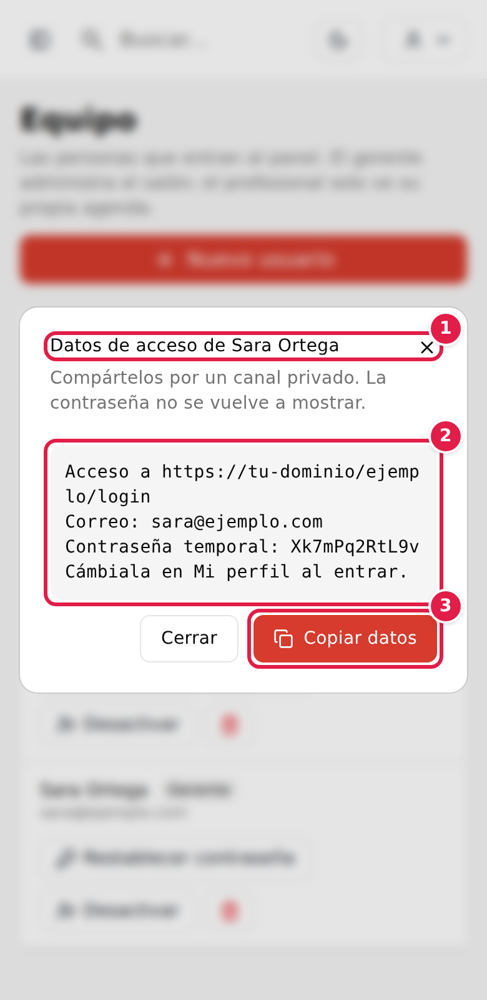

> 📸 **Captura 39** — Mensaje **Datos de acceso**. Elementos a resaltar: 1) título con el nombre de la persona, 2) enlace, correo y contraseña temporal, 3) botón **Copiar datos**. Encuadre: ventana completa. Nombre de archivo sugerido: `39_equipo_contrasena.png`

Al crear la cuenta, Afilao te muestra una ventana con los datos de acceso.

1. Pulsa **Copiar datos** (número 3). Verás *Datos copiados*.
2. Envíalos a la persona por un canal privado, como un mensaje directo.
3. Pulsa **Cerrar**.

> ⚠️ **Atención:** La contraseña temporal se muestra **una sola vez**. Si cierras la ventana sin copiarla, usa **Restablecer contraseña**.

La persona entra como en el [capítulo 5](#5-antes-de-empezar) y cambia su contraseña.

### ⚠️ Si algo sale mal

| Ves este mensaje | Qué hacer |
|---|---|
| *Ya existe un usuario con ese correo en este salón* | Esa persona ya tiene cuenta. Usa **Restablecer contraseña**. |
| *Todos tus profesionales ya tienen acceso. Crea primero la ficha en Profesionales.* | Crea la ficha de la persona en **Profesionales**. |
| *Tu plan … permite hasta … profesionales* | Llegaste al máximo de tu plan. Escribe a soporte. |

## Restablecer una contraseña

Úsalo cuando alguien olvidó su contraseña.

1. Busca a la persona en **Equipo**.
2. Pulsa **Restablecer contraseña**.
3. Copia los datos nuevos y envíaselos.

✅ **Resultado esperado:** Se abre la ventana con una contraseña temporal nueva. La persona debe entrar de nuevo.

## Desactivar, activar o borrar

- **Desactivar**: la persona no puede entrar, pero conservas su historial. El botón pasa a decir **Activar**.
- La papelera borra la cuenta. Afilao pregunta antes: *¿Eliminar a … ? Perderá el acceso.*

> 💡 **Consejo:** Si alguien dejó de trabajar contigo, **desactívalo** en lugar de borrarlo.

## Mi perfil

Cada persona tiene su perfil.

1. Pulsa el icono de persona, arriba a la derecha.
2. Pulsa **Mi Perfil**.

Allí puedes:

- Cambiar tu **Nombre** o tu **Correo (es tu usuario)**, y pulsar **Guardar cambios**. Verás *Perfil guardado correctamente*.
- Cambiar tu contraseña. Mira el [capítulo 5](#5-antes-de-empezar).
- Pulsar **Cerrar sesión**.
- Si eres profesional, vincular tu Telegram. Mira el [capítulo 10](#10-el-bot-de-telegram).
- Ver tus citas en tu propio calendario, con **Ver mis citas en mi calendario**. Está justo aquí abajo.

### Ver tus citas en tu calendario

Puedes suscribir tu agenda en Google Calendar, Apple Calendar u Outlook. Las citas nuevas, los cambios y las cancelaciones aparecen solas en tu teléfono, sin abrir Afilao. El dueño y los administradores ven la agenda de todo el salón. Un profesional ve solo sus citas.

👉 Mira la **Captura 48**.

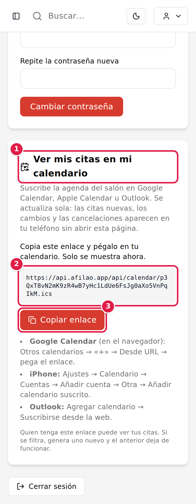

> 📸 **Captura 48** — **Mi perfil**, sección **Ver mis citas en mi calendario**, con el enlace recién creado. Elementos a resaltar: 1) título de la sección, 2) enlace, 3) botón **Copiar enlace**. Encuadre: recorte de la sección. Nombre de archivo sugerido: `48_calendario_suscrito.png`

1. Ve a **Mi Perfil**.
2. En **Ver mis citas en mi calendario**, pulsa **Activar mi calendario**.
3. Pulsa **Copiar enlace** (número 3).
4. Pega el enlace en tu calendario:
   - **Google Calendar** (en el navegador): **Otros calendarios**, el signo **+**, **Desde URL**, y pega el enlace.
   - **iPhone:** **Ajustes › Calendario › Cuentas › Añadir cuenta › Otra › Añadir calendario suscrito**.
   - **Outlook:** **Agregar calendario › Suscribirse desde la web**.

✅ **Resultado esperado:** Tus citas aparecen en tu calendario. Se actualizan cada pocas horas; los calendarios deciden cada cuánto.

> ⚠️ **Atención:** El enlace se muestra **una sola vez**. Quien lo tenga puede ver tus citas. Guárdalo bien y no lo compartas.

Si lo pierdes o se filtra, pulsa **Generar un enlace nuevo**. El anterior deja de funcionar. Para dejar de recibir tus citas en el calendario, pulsa **Desactivar**.

> ⚠️ **Atención:** Tu correo es tu usuario. Si lo cambias, la próxima vez entra con el correo nuevo.

---

# 15. Recursos, Galería, Notificaciones y Facturación

Estas cuatro pantallas se usan menos. Aquí tienes lo básico de cada una.

## Recursos

Un recurso es algo que se ocupa durante una cita: una silla, una cabina, una mesa de pedicura. Sirve cuando no puedes atender más clientes que sillas tienes.

**Menú › Recursos**

👉 Mira la **Captura 40**.

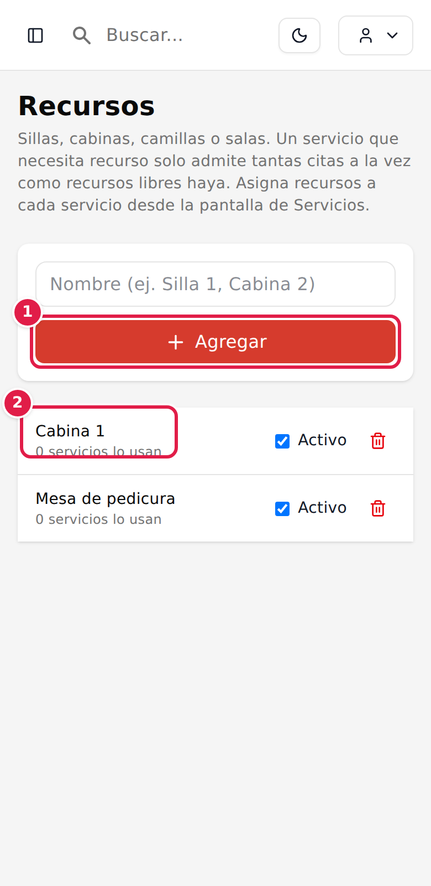

> 📸 **Captura 40** — Pantalla **Recursos**. Elementos a resaltar: 1) botón **Agregar**, 2) un recurso de la lista. Encuadre: pantalla completa del móvil. Nombre de archivo sugerido: `40_recursos.png`

1. Escribe el nombre en el campo **Nombre (ej. Silla 1, Cabina 2)**.
2. Pulsa **Agregar** (número 1).
3. Para asignarlo a un servicio, abre **Servicios**, edita el servicio y marca el recurso en **Recursos que necesita**.

✅ **Resultado esperado:** Ves el aviso *Recurso creado*.

Cada recurso muestra cuántos servicios lo usan y la casilla **Activo**. Quita la casilla para dejar de usarlo. La papelera lo borra, con la pregunta *¿Seguro que quieres eliminar este recurso?*.

> ❓ **Nota:** Un servicio que usa recurso solo admite tantas citas a la vez como recursos libres haya. Los profesionales que reservan por cupos no usan recursos.

## Galería

Aquí guardas fotos de tus diseños, cada una con su servicio.

**Menú › Galería**

👉 Mira la **Captura 41**.

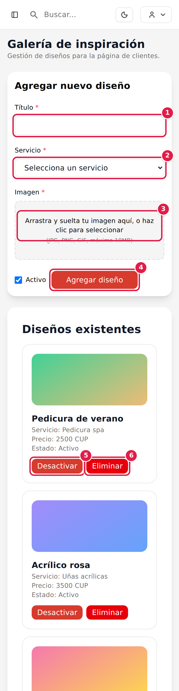

> 📸 **Captura 41** — Pantalla **Galería de inspiración**. Elementos a resaltar: 1) **Título**, 2) **Servicio**, 3) zona de la imagen, 4) botón **Agregar diseño**, 5) **Desactivar**, 6) **Eliminar**. Encuadre: pantalla completa del móvil. Nombre de archivo sugerido: `41_galeria.png`

1. Escribe el **Título** (número 1).
2. Elige el **Servicio** (número 2).
3. Toca la zona **Arrastra y suelta tu imagen aquí, o haz clic para seleccionar** (número 3) y elige una foto. Sirven JPG, PNG y GIF de hasta 10 MB.
4. Deja marcado **Activo**.
5. Pulsa **Agregar diseño** (número 4).

✅ **Resultado esperado:** Ves el aviso *Diseño agregado correctamente*. El diseño sale en **Diseños existentes**.

Cada diseño tiene **Desactivar** y **Eliminar**.

> ❓ **Nota:** Por ahora la galería es solo para ti. Tus clientes todavía no la ven en la página de reserva.

## Notificaciones

Aquí ves todos los avisos que Afilao envió a tus clientes: correos y mensajes de Telegram.

**Menú › Notificaciones**

👉 Mira la **Captura 42**.

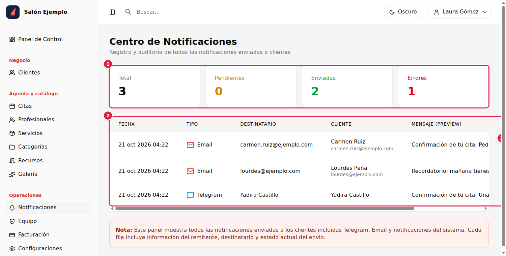

> 📸 **Captura 42** — Pantalla **Centro de Notificaciones** en el computador. Elementos a resaltar: 1) los cuatro contadores, 2) la tabla de avisos, 3) un aviso con **Error**. Encuadre: pantalla completa. Nombre de archivo sugerido: `42_notificaciones.png`

1. Arriba (número 1) ves cuatro números: **Total**, **Pendientes**, **Enviadas** y **Errores**.
2. Abajo (número 2) ves una tabla. Cada fila tiene la fecha, el tipo (**Email** o **Telegram**) y el destinatario. También tiene el cliente, un trozo del mensaje y el estado.
3. Un aviso con **Error** (número 3) no llegó. Busca al cliente en **Clientes** y revisa su correo o su teléfono.

> 💡 **Consejo:** En el celular, la tabla es ancha. Desliza hacia los lados para ver todas las columnas.

## Facturación

Aquí el dueño ve el plan de Afilao que tiene contratado.

**Menú › Facturación** (solo lo ve el dueño)

👉 Mira la **Captura 43**.

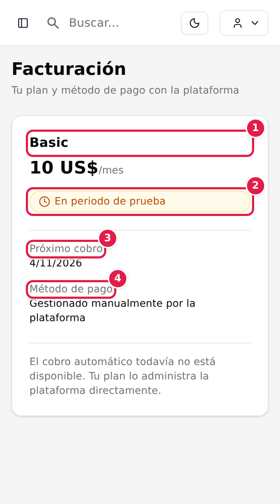

> 📸 **Captura 43** — Pantalla **Facturación**. Elementos a resaltar: 1) nombre del plan, 2) estado del plan, 3) **Próximo cobro**, 4) **Método de pago**. Encuadre: pantalla completa del móvil. Nombre de archivo sugerido: `43_facturacion.png`

Ves el nombre de tu plan y su precio. También ves el estado, por ejemplo **En periodo de prueba**, la fecha de **Próximo cobro** y el **Método de pago**.

> ❓ **Nota:** Por ahora el cobro lo gestiona Afilao de forma manual. No tienes que pagar desde esta pantalla. Para cambiar de plan, escribe a soporte.

---

# 16. Tareas de principio a fin

Aquí juntamos las tareas más comunes, de la primera a la última acción. Cada una te manda al capítulo con los detalles.

## Abrir tu salón por primera vez

Hazlo una sola vez, en este orden. Tardas unos 30 minutos.

1. Entra con tu enlace, tu correo y tu contraseña temporal. Mira el [capítulo 5](#5-antes-de-empezar).
2. Cambia tu contraseña en **Mi Perfil**.
3. Ve a **Menú › Configuraciones › Negocio**. Elige tu **Tipo de negocio** y revisa la **Zona horaria**.
4. Ve a la ficha **Marca**. Sube tu logo y elige tu color.
5. Ve a la ficha **Horarios**. Revisa los días y horas en que abres.
6. Ve a la ficha **Cierres**. Agrega los feriados que ya conoces.
7. Ve a **Menú › Categorías**. Crea tus categorías.
8. Ve a **Menú › Servicios**. Crea tus servicios con precio y duración.
9. Ve a **Menú › Profesionales**. Crea una ficha por cada persona. Elige si reserva por hora o por cupos.
10. Ve a **Menú › Equipo**. Crea las cuentas de tu gente y entrégales sus datos.
11. Ve a **Configuraciones › Reservas**. Copia tu enlace e imprime tu cartel con QR.
12. (Opcional) Conecta tu bot de Telegram. Mira el [capítulo 10](#10-el-bot-de-telegram).
13. Abre tu enlace de reserva en otro celular. Haz una reserva de prueba.
14. Entra a **Citas** y comprueba que la ves.

✅ **Resultado esperado:** Tu salón está listo para recibir reservas.

> 💡 **Consejo:** Después de la prueba, cancela la cita de prueba para liberar el horario.

## Atender a un cliente que llama por teléfono

1. Pulsa **Menú › Clientes**.
2. Escribe el nombre o el teléfono en **Buscar clientes...**.
3. Si no existe, pulsa **Nuevo cliente** y guárdalo. Mira el [capítulo 8](#8-clientes).
4. Pulsa **Menú › Citas**.
5. Pulsa **Nueva cita**.
6. Elige el cliente, el servicio, el profesional, la fecha y la hora.
7. Pulsa **Guardar cita**.

✅ **Resultado esperado:** Ves el aviso *Se creó la cita*. Tu cliente recibe su confirmación.

## Cambiar la cita de un cliente

1. Pulsa **Menú › Citas**.
2. Toca el día de la cita en el calendario.
3. Pulsa **Editar cita** en su tarjeta.
4. Cambia la **Fecha de la cita** o la **Hora de Inicio**.
5. Pulsa **Guardar cita**.

✅ **Resultado esperado:** Ves el aviso *Se actualizó la cita*.

## Dar de alta a un profesional nuevo, con acceso

1. Pulsa **Menú › Servicios**. Revisa que existan los servicios que hará.
2. Pulsa **Menú › Profesionales** y luego **Agregar profesional**.
3. Escribe su **Nombre**, su **Correo** y su **Teléfono**.
4. Elige **Cómo recibe reservas** y revisa su horario o sus cupos.
5. En **Servicios que realiza**, toca los servicios que hace.
6. Pulsa **Guardar**.
7. Pulsa **Menú › Equipo** y luego **Nuevo usuario**.
8. Elige **Profesional (solo ve su agenda)** y escoge su nombre.
9. Pulsa **Crear usuario**.
10. Pulsa **Copiar datos** y envíaselos por mensaje privado.

✅ **Resultado esperado:** La persona entra a Afilao y ve solo su agenda.

## Mandar a un profesional de vacaciones

1. Pulsa **Menú › Profesionales**.
2. Toca el lápiz del profesional.
3. Baja hasta **Ausencias (vacaciones, descansos)**.
4. Elige la fecha de inicio y la de fin.
5. Escribe el **Motivo (opcional)**.
6. Pulsa **Añadir** y luego **Guardar**.
7. Revisa en **Citas** si ya tenía citas esos días. Reprográmalas.

✅ **Resultado esperado:** Nadie puede reservar con esa persona en esas fechas.

## Cerrar tu negocio un día

1. Pulsa **Menú › Configuraciones** y luego la ficha **Cierres**.
2. Elige la **Fecha de Cierre**.
3. Escribe el **Motivo (Opcional)**.
4. Pulsa **Agregar Día**.
5. Revisa en **Citas** si ya había citas ese día. Avisa a tus clientes y reprográmalas.

✅ **Resultado esperado:** Ese día sale como **No disponible**. Nadie puede reservar.

## Cambiar el precio de un servicio

1. Pulsa **Menú › Servicios**.
2. Busca el servicio.
3. Toca el lápiz.
4. Cambia el **Precio**.
5. Pulsa **Guardar**.

✅ **Resultado esperado:** Ves el aviso *Servicio actualizado correctamente*. Las citas que ya existen mantienen el precio de cuando se reservaron.

## Pasar a un profesional a trabajar por cupos

1. Pulsa **Menú › Profesionales**.
2. Toca el lápiz del profesional.
3. Marca **Por cupos**.
4. Añade las horas de cada día con **+ cupo**. Usa **Copiar a todos los días** si son las mismas.
5. Pulsa **Guardar**.

✅ **Resultado esperado:** Tus clientes ven solo esas horas con ese profesional.

> ⚠️ **Atención:** Las citas que ya tiene se quedan en su hora. No las toques si no hace falta.

## Recuperar el acceso de alguien de tu equipo

1. Pulsa **Menú › Equipo**.
2. Busca a la persona.
3. Pulsa **Restablecer contraseña**.
4. Pulsa **Copiar datos** y envíaselos.

✅ **Resultado esperado:** La persona entra con la contraseña temporal y la cambia en **Mi Perfil**.

---

# 17. Preguntas frecuentes

## Sobre tus clientes

**¿Mis clientes tienen que crear una cuenta?**
No. Reservan con su nombre y un teléfono o un correo. Nada más.

**¿Cómo comparto mi página de reservas?**
Ve a **Configuraciones › Reservas** y pulsa **Copiar**. Pega el enlace en tu Instagram, tu WhatsApp o Google Maps. También puedes imprimir el cartel con QR.

**¿Mis clientes pueden cancelar o cambiar su cita?**
Sí. Usan el enlace **Cambiar o cancelar mi cita** que reciben al reservar. Hasta cuántas horas antes lo decides tú, en **Configuraciones › Reservas**.

**¿Por qué un cliente no ve horas para un día?**
Hay cuatro causas posibles. Ese día cierras. El profesional no trabaja. No quedan huecos. O pasó el límite de **Reservas hasta (días hacia adelante)**. Mira el [capítulo 18](#18-solución-de-problemas).

**¿Qué pasa si dos clientes quieren la misma hora a la vez?**
Gana el primero. Al segundo Afilao le pide que elija otra hora.

## Sobre tu cuenta

**Olvidé mi contraseña. ¿Qué hago?**
Si eres gerente o profesional, pídele al dueño que pulse **Restablecer contraseña** en **Equipo**. Si eres el dueño, escribe a soporte.

**¿Puedo entrar desde varios dispositivos?**
Sí. Entra con tu mismo correo y contraseña en cada uno. Si cambias tu contraseña, los demás dispositivos te pedirán entrar de nuevo.

**¿Por qué no veo la opción Equipo o Facturación?**
Solo el dueño las ve. Un gerente no, y un profesional ve aún menos.

**¿Otros negocios pueden ver mis datos?**
No. Cada negocio ve solo lo suyo.

## Sobre el uso diario

**¿Puedo ver mis citas en el calendario de mi teléfono?**
Sí. En **Mi Perfil**, pulsa **Activar mi calendario** y pega el enlace en Google Calendar, Apple Calendar u Outlook. Mira el [capítulo 14](#14-equipo-y-mi-perfil).

**¿Mis clientes pueden guardar su cita en su calendario?**
Sí. Al reservar ven los botones **Google Calendar** y **Apple / Outlook (.ics)**. También están en la página **Tu reserva**.

**¿Cómo respondo rápido a un cliente que pregunta por un hueco?**
En **Citas**, elige el día, pulsa los tres puntos y luego **Copiar horas libres**. Pega el texto en WhatsApp.

**¿Puedo usar Afilao sin internet?**
No. Necesitas conexión para entrar y para ver tu agenda.

**¿Puedo borrar un cliente?**
Solo si no tiene citas. Si tiene alguna, aunque esté cancelada, Afilao no te deja borrarlo. Así conservas tu historial. Un cliente sin citas se borra y no se puede recuperar.

**¿Cuál es la diferencia entre Horarios y Cierres?**
**Horarios** son tus días y horas normales de cada semana. **Cierres** son días sueltos en que no abres, como un feriado.

**¿Cómo cambio las palabras, por ejemplo cita por turno?**
Ve a **Configuraciones › Negocio** y cambia el **Vocabulario**.

**¿Cuánto antes pueden reservar mis clientes?**
Tú lo decides con **Antelación mínima para reservar (horas)**, en **Configuraciones › Reservas**.

**¿Telegram es obligatorio?**
No. Si no lo usas, tus clientes reciben los avisos por correo.

**¿Puedo cambiar mi logo cuando quiera?**
Sí. Ve a **Configuraciones › Marca**, sube el logo nuevo y pulsa **Guardar marca**.

---

# 18. Solución de problemas

Busca tu síntoma en la tabla. Si no lo ves, prueba primero lo básico:

1. Recarga la página.
2. Cierra la sesión y entra de nuevo.
3. Prueba con otro navegador.
4. Si sigue igual, escribe a soporte. Mira el [capítulo 20](#20-cómo-contactar-a-soporte).

## Para ti

| Síntoma | Causa probable | Qué hacer |
|---|---|---|
| No puedo entrar. | Correo o contraseña mal escritos. Mayúsculas o espacios de más. | Copia y pega tu contraseña. Revisa tu correo. Si sigue, pide que te la restablezcan. |
| Dice *Demasiados intentos*. | Te equivocaste varias veces. | Espera unos minutos y prueba de nuevo. |
| Dice *Este salón está suspendido*. | Tu cuenta de Afilao está detenida. | Escribe a soporte. |
| Los cambios no se guardan. | Faltó pulsar el botón de guardar, o salió un aviso rojo. | Pulsa **Guardar** o **Guardar ajustes**. Lee el aviso rojo. |
| Las citas salen a una hora equivocada. | La **Zona horaria** de tu negocio está mal. | Corrígela en **Configuraciones › Negocio**. |
| Un día sale **Completo** y quedan huecos. | Tienes un **Límite de citas** para ese día. | Cámbialo en **Configuraciones › Horarios**. |
| No puedo crear un profesional o un usuario. | Llegaste al máximo de tu plan. | Escribe a soporte para cambiar de plan. |
| No puedo borrar un profesional. | Ya tiene citas. | Quítale la marca **Activo**. |
| No se imprime el cartel. | El navegador bloqueó la ventana. | Permite las ventanas emergentes y pulsa **Imprimir cartel** otra vez. |
| La pantalla se ve cortada. | El navegador está desactualizado o la página no cargó bien. | Recarga. Actualiza tu navegador. |
| Cambié mi contraseña y me pidió entrar de nuevo. | Es normal: se cerraron las demás sesiones. | Entra con la contraseña nueva. |
| Mi calendario del teléfono no muestra una cita nueva. | Google, Apple y Outlook actualizan los calendarios suscritos cada pocas horas. | Espera un poco. En **Mi Perfil** puedes generar un enlace nuevo si lo perdiste. |

## Para tus clientes

| Síntoma | Causa probable | Qué hacer |
|---|---|---|
| No ve ninguna hora. | Cierras ese día. El profesional tiene una ausencia. El día está lleno. | Revisa **Cierres** y las **Ausencias**. Pídele que pruebe otro día. |
| No ve un servicio. | El servicio está **Inactivo** o sin la marca **Visible para los clientes**. | Revísalo en **Servicios**. |
| No ve a un profesional. | Tiene quitada la casilla **Acepta reservas en línea**, o no hace ese servicio. | Revisa su ficha en **Profesionales**. |
| Dice *Enlace no válido o vencido*. | El enlace de su cita está incompleto o ya no existe. | Busca su cita en tu **Agenda de Citas** y cámbiala tú. |
| No recibió el correo. | Escribió mal su correo, o el mensaje cayó en spam. | Revisa **Notificaciones**. Pídele que mire su carpeta de spam. |
| No puede cancelar su cita. | Pasó el plazo de **El cliente puede cancelar hasta (horas antes)**. | Cancélala tú desde **Citas**. |

## Del bot de Telegram

| Síntoma | Causa probable | Qué hacer |
|---|---|---|
| El bot no responde. | Escribiste mal el comando, o el bot se desconectó. | Prueba `/citas`. Revisa **Configuraciones › Avisos**. |
| No me llegó el resumen de las 8:00. | No había citas ese día, el resumen está apagado, tu chat no está vinculado, o la **Zona horaria** del negocio está mal. | Revisa **Configuraciones › Avisos** (casilla del resumen y `/vincular`) y la zona horaria en **Negocio**. |
| Dice *Código inválido*. | El código ya se usó o se copió mal. | Recarga Afilao y copia el código nuevo. |
| Dice *Telegram no reconoce ese token*. | El token está incompleto o tiene espacios. | Cópialo de nuevo desde **@BotFather**. |
| Un cliente no recibe avisos por Telegram. | No tocó **Recibir avisos por Telegram**, o bloqueó el bot. | Recibirá los avisos por correo. Puede volver a activarlos desde su enlace de la cita. |

---

# 19. Glosario

| Término | Qué significa |
|---|---|
| **Agenda** | La lista de tus citas, por día o por semana. |
| **Ausencia** | Días en que un profesional no trabaja, como vacaciones. |
| **Bot** | Un asistente automático dentro de Telegram. Manda avisos y responde comandos. |
| **Categoría** | Un grupo de servicios. Por ejemplo, *Manicura* o *Pedicura*. |
| **Cierre** | Un día suelto en que tu negocio no abre. |
| **Cita** | Una reserva de un cliente, con día, hora, servicio y profesional. |
| **Cliente** | Una persona que te visita. Aparece en **Clientes**. |
| **Código QR** | Un cuadro con puntos que el celular lee con la cámara. Abre tu página de reserva. |
| **Contraseña temporal** | Una contraseña de un solo uso que recibes para entrar la primera vez. La cambias enseguida. |
| **Cupo** | Una hora exacta de un profesional, para un solo cliente. |
| **Dueño** | El usuario con acceso a todo en el negocio. |
| **Enlace de reserva** | La dirección web donde tus clientes reservan. |
| **Enlace secreto** | La dirección que recibe el cliente para cambiar o cancelar su cita. |
| **Ficha** | Una de las seis secciones de **Configuraciones**. También, el registro de un cliente o profesional. |
| **Gerente** | El usuario que administra el negocio, pero no ve **Equipo** ni **Facturación**. |
| **Horario exacto** | Una hora fija que añades a un día, en lugar de horas cada 30 minutos. |
| **Navegador** | El programa con el que abres páginas de internet: Chrome, Edge, Safari o Firefox. |
| **Notificación** | Un aviso que Afilao envía a un cliente, por correo o Telegram. |
| **Panel de control** | La primera pantalla al entrar. Resume tu día. |
| **Plan** | El paquete de Afilao que tiene tu negocio. Define cuántos profesionales puedes tener. |
| **Profesional** | Una persona que atiende a los clientes. |
| **Recurso** | Algo que se ocupa durante una cita: una silla, una cabina o una mesa. |
| **Reserva** | Cuando un cliente aparta una cita desde tu página. |
| **Servicio** | Lo que ofreces, con precio y duración. |
| **Sesión** | El tiempo en que estás dentro de Afilao con tu usuario. |
| **Telegram** | Una aplicación de mensajes gratuita, parecida a WhatsApp. |
| **Token** | Un texto largo con letras y números, que funciona como la llave de tu bot. No lo compartas. |
| **Usuario** | Una persona con cuenta para entrar a Afilao. Su usuario es su correo. |
| **Vocabulario** | Las palabras que usa Afilao en tu negocio, como *cita* o *turno*. |
| **Zona horaria** | El huso horario de tu ciudad. Hace que las horas de las citas sean correctas. |

---

# 20. Cómo contactar a soporte

¿Algo no funciona y este manual no te ayudó? Escríbenos. Estamos para ayudarte.

| Cómo | Dato |
|---|---|
| **Correo** | yordenis@yordeniscorreoso.com |
| **Teléfono** | +1 (305) 792-8837 |
| **Horario de atención** | De 9am a 5pm |

Fuera de ese horario, escríbenos por correo. Te respondemos al volver.

## Qué información enviar

Cuanta más información nos des, más rápido te ayudamos. Escribe estas seis cosas:

1. El **nombre de tu salón**.
2. **Tu nombre** y el **correo** con el que entras.
3. **Qué intentabas hacer.** Por ejemplo: *crear una cita para mañana*.
4. **Qué pasó.** Copia el mensaje exacto que viste.
5. **Una captura de pantalla** del problema.
6. Tu **dispositivo y navegador.** Por ejemplo: *celular Android, Chrome*.

💡 **Consejo:** Para sacar una captura, pulsa a la vez dos botones del celular. Casi siempre son el de encendido y el de bajar el volumen.

## Un mensaje de ejemplo

> Hola. Soy Laura Gómez, del salón Salón Ejemplo. Mi correo es laura@ejemplo.com.
> Intentaba crear una cita para mañana a las 9:00 y me salió el aviso *Esa hora ya no está disponible. Elige otra.*
> Uso un celular Android con Chrome. Adjunto una captura.

> ⚠️ **Atención:** Nunca nos envíes tu contraseña ni el token de tu bot. No los necesitamos.

---

**Afilao · Manual de usuario · Versión 1.0 · Octubre de 2026**
